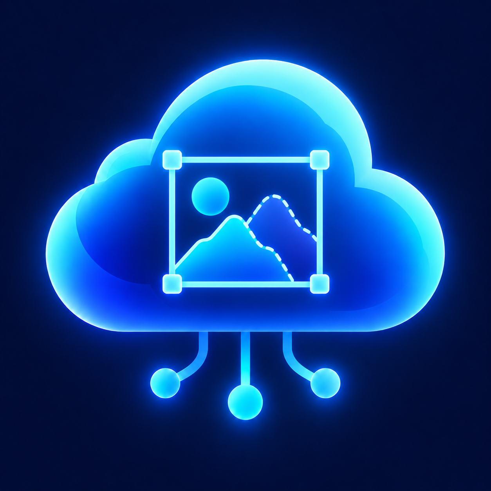

# SAMcloud



SAMcloud is a local photogrammetry application. It reconstructs 3D point
clouds from drone, standard-camera, and 360 degree Insta360 imagery with
COLMAP. It then assigns semantic LAS classes with SAM3 and checks every class
geometrically. The project was developed for the Digital Twin Programming
module at HSLU.

## Contents

1. [Overview](#overview)
2. [Processing pipeline](#processing-pipeline)
3. [Semantic classification](#semantic-classification)
4. [LAS export and coordinate systems](#las-export-and-coordinate-systems)
5. [User interface](#user-interface)
6. [Capture types, processing modes, and coordinates](#capture-types-processing-modes-and-coordinates)
7. [Architecture](#architecture)
8. [Configuration](#configuration)
9. [Project files](#project-files)
10. [Installation and start on Windows](#installation-and-start-on-windows)
11. [Tests](#tests)
12. [Scope and independent work](#scope-and-independent-work)
13. [Author and license](#author-and-license)

## Overview

SAMcloud provides a guided workflow comparable to common photogrammetry
applications:

1. Select images.
2. Align the cameras.
3. Optionally define ground control points.
4. Generate a dense point cloud.
5. Classify it semantically.
6. Export a reusable LAS file.

Every job is stored as a reopenable local project. Source images stay at their
original location.

Main features:

- **Reconstruction** with COLMAP 4.2.0 (CUDA): sparse model, GPS/RTK alignment,
  dense stereo, and fusion.
- **Semantic classification** with SAM3 and the SegEarth-OV3 method: three SAM3
  heads are fused and the results are voted across all camera views. Outdoor
  projects can use **FlurSeg** instead, the project's own segmentation model
  (about 15x faster, fixed classes). SAM3 projects can edit and extend their
  classes when the project is created.
- **Geometric refinement:** height above ground, flatness, and neighbourhood
  checks. They use the SAM3 confidence, for example to turn flat roofs that
  SAM3 labels as ground into building.
- **Review before export:** a built-in 3D viewer shows the RGB and class views
  and can show or hide individual classes. The LAS export (Cyclone 3DR / ASPRS
  LAS 1.4 codes) is started manually.

## Processing pipeline

A full run executes the following stages in order
(`samcloud/engine/pipeline.py`). Progress and stage durations are shown on the
dashboard and written to `reports/`.

| # | Stage | Tool | Result |
|---|---|---|---|
| 1 | Feature extraction | COLMAP | image features in `database.db` |
| 2 | Image matching | COLMAP | feature matches |
| 3 | Sparse reconstruction | COLMAP mapper | camera poses and sparse cloud (`products/sparse/0`) |
| 4 | GPS alignment (drone GPS/RTK only) | COLMAP `model_aligner`, ENU | georeferenced model (`products/sparse/0_geo`), metres, z up |
| 5 | Dense preparation (undistortion) | COLMAP | undistorted images and PINHOLE TXT model in `products/dense/` |
| – | *Optional pause for control points* | SAMcloud UI | control point observations; GCP georeferencing is applied on resume |
| 6 | Dense stereo, fusion | COLMAP | `products/dense/fused.ply` and visibility file `fused.ply.vis` |
| 7 | Classification | Ultralytics SAM3 or FlurSeg (outdoor) | `classified_raw.ply`, `classified_scores.npz` |
| 8 | Improve & filter (workflow step 6, see below) | Depth-Anything-V2, depth maps, SAM labels | cleaned and filled `classified_raw.ply` |
| 9 | Geometric refinement (part of step 6) | `samcloud/engine/geometry` | `classified.ply`, `reports/geometry_summary.json` |
| 10 | LAS export (manual, workflow step 7) | laspy, PyProj | LAS 1.4 with CRS WKT, class mapping, and CRS-appropriate scale |

The dashboard shows seven workflow steps (imagery, alignment, control points,
dense cloud, SAM3, **improve & filter**, export), each with its own progress
and remaining time. Remaining times are learned separately per capture type
(drone, camera, 360°) in `projects/.samcloud_stage_rates.json`, so 360 runs
never distort the drone estimate.

### Improve & filter (step 6)

COLMAP's depth maps (and indoors the Depth-Anything-V2 depth) are kept until
this step has finished:

1. **Depth-Anything-V2 (indoor only).** A metric indoor depth is predicted for
   every dense view and aligned to COLMAP's own depth map per view
   (`colmap ≈ scale·DA + shift`, robust fit). Views without enough COLMAP depth
   (white walls) use the median fit of all good views, unless that contradicts
   the COLMAP pixels they do have (`samcloud/colmap/depth_prior.py`).
2. **Floating points removed (all capture types).** A point is removed when at
   least three cameras reliably measure a surface *behind* it and they
   outnumber the cameras that measure the point itself. Indoors the aligned
   Depth-Anything depth fills the pixels COLMAP left empty
   (`samcloud/colmap/point_cleaning.py`).
3. **Floors, ceilings and walls filled (indoor only).** Planes are fitted to
   the points SAM labelled floor, ceiling or wall. Gaps of up to 1.5 m inside a
   plane are filled on a 1 cm grid where at least three cameras see the spot
   unoccluded with that SAM class, they are at least 60 % of all cameras seeing
   it, and neither COLMAP nor Depth-Anything measures a surface behind it, so
   doors, windows and openings stay open (`samcloud/colmap/plane_fill.py`).
4. **Geometric refinement** as described below.

Settings live in `config/colmap.yml` (`point_cleaning`, `plane_fill`, with a
separate profile per capture type) and on the project settings page (depth
model Large / Small / Off).

## Semantic classification

### Classes

The classes follow the Nomivox preset (`presets/default.json`) and are stored
in `config/classes.json`: per class set the class order, the prompt list of
every class, its LAS code, colour and German label. ID 0 is always
*Unknown/noise* (LAS code 1, unclassified). Indoor uses the Nomivox classes of
scene `indoor` or `both`, outdoor those of scene `outdoor` or `both`.

| Class set | Classes |
|---|---|
| `outdoor` (23) | ground, road, sidewalk, curb, low vegetation, tree, building, vehicle, construction machinery, utility pole, traffic sign, fence, outdoor wall, power line, construction material, water, window, stairs, column, beam, steel structure, manhole, tree trunk |
| `indoor` (19) | construction material, wall, ceiling, floor, door, window, stairs, railing, column, beam, steel structure, pipe, cable, electrical, HVAC, ceiling equipment, furniture, appliances, sanitary fixtures |

Every prompt is sent to SAM3 on its own and a class keeps the best of its
prompts. Synonyms must never be joined into one long comma-separated prompt:
that drives SAM3's presence score towards zero (walls and ceilings were lost).
The image backbone runs once per tile and the prompts run in batches of 8
(larger batches overflow 24 GB of VRAM on 3200 px drone photos and get about 10x slower).
To update the classes from a newer Nomivox preset:

```bat
venv\Scripts\python -m samcloud.tools.import_nomivox_classes D:\Nomivox\presets\default.json
```

### Own classes per project (SAM3)

When creating a project with SAM3 (outdoor, and always for indoor), the panel
**Klassen anpassen (SAM3)** lets you change the prompts of every standard class
and add own classes (English name, German label, prompts, colour). The project
then gets its own `config/classes.json`, which the pipeline, the LAS export and
the dense viewer use instead of the global file. Standard classes keep their ids
and names (step 6 and the geometry rules use them); own classes are appended and
get free LAS codes from 64.

### FlurSeg (outdoor alternative to SAM3)

FlurSeg is an EoMT-DINOv3-L model trained on SAM3 pseudo-labels with 11 classes:
other, ground, paved surface, low vegetation, tree, building, vehicle,
construction, curb, road marking and utility cover. `config/flurseg.yml` maps them
to the SAMcloud outdoor classes (paved surface and road marking to road,
construction to construction machinery, utility cover to manhole, other to
unknown). Inference uses a 768 px sliding window (stride 384) in fp16; the
multi-view voting, step 6 and geometric refinement are the same as for SAM3.
Its classes are fixed by the training and cannot be customised.

Grütistrasse test (291 drone photos, same dense cloud with 65 M points, SAM3 as
reference):

| | SAM3 | FlurSeg |
|---|---|---|
| Classification per photo | ~30 s | ~2 s |
| Full run incl. step 6 and geometry | ~2.5 h | 18.5 min |
| Agreement with SAM3 (FlurSeg's 11-class taxonomy) | – | 93 %, kappa 0.88 |

Ground, low vegetation, vehicle, paved surface and building agree closely
(IoU 0.79–0.98). Tree, manhole, construction and curb are weaker, and FlurSeg
cannot separate sidewalk from road or detect fences, poles, signs, walls and
other fine classes. The model folder (`models/flurseg_eomt_dinov3l_*`) is not
part of the repository; it will be published on Hugging Face together with its
`EVALUATION.md`.

The dashboard button **Klassifizierung neu rechnen** (pipeline `--reclassify`)
re-runs only classification, step 6 and geometry on the kept dense cloud, so
SAM3 and FlurSeg can be compared on exactly the same points.

More prompts cost time: indoor 360 runs take about 2 s per cubemap face
(one SAM pass per 1024 px face); large drone photos are tiled and take longer.

### Step 1: SAM3 per image (SegEarth-OV3)

The method follows *SegEarth-OV3: Exploring SAM 3 for Open-Vocabulary
Semantic Segmentation in Remote Sensing Images* (arXiv:2512.08730). It is
implemented in `samcloud/engine/sam_labeler.py`.

1. **Tiling:** every undistorted image is split into evenly spaced tiles
   (768, 1008, or 1280 px, overlap at least 0.2) so thin structures are not lost.
2. **Raw heads:** SAM3 runs once per tile with all class prompts. SAMcloud reads
   the three heads separately instead of the final masks:
   - presence score S_pres per class
   - semantic map P_sem
   - instance masks P_inst with confidence s_conf
3. **Instance aggregation:** for each class and pixel,
   `P_inst_agg = max_k(P_inst_k · s_conf_k)`. Only queries with
   `s_conf ≥ query_threshold` (0.4) count.
4. **Dual-head fusion:** `P_fused = max(P_sem, P_inst_agg)`. The instance head
   gives sharp edges on objects, and the semantic head gives continuous surfaces
   such as ground and vegetation.
5. **Presence gate:** `P_final = P_fused · S_pres`. Classes that SAM3 considers
   absent from the image are suppressed.

### Step 2: Multi-view voting in 3D

`samcloud/engine/classify.py` projects each dense point into every camera in
which COLMAP marks it visible (`fused.ply.vis`, occlusion-aware). The per-class
`P_final` values of these views are summed.

- A view whose best class is below `background_threshold` (0.4) counts as
  background and does not vote.
- The class with the largest sum wins. Points with fewer than `min_votes`
  voting views stay unknown.
- For every point, the confidence is saved in `classified_scores.npz`. It is
  the mean `P_final` of the winning class over the voting views, stored
  together with the second-best class and its confidence.

### Step 3: Geometric refinement

`samcloud/engine/geometry/` checks every point against geometric rules for its
class and corrects implausible labels.

**When it runs:**

- Only for georeferenced outdoor projects (local ENU coordinates in metres,
  z up).
- Otherwise it is skipped and the reason is recorded in the summary.

**Measurements per point:**

| Measurement | Meaning | Module |
|---|---|---|
| Height above ground (HAG) | distance to a robust terrain raster. The raster uses 1 m cells, a low percentile, and only ground-class points with SAM3 confidence ≥ 0.5. Elevated plateaus narrower than 40 m are removed. | `terrain.py` |
| Height above local support (HLS) | height above the nearest horizontal surface; on a roof this is the roof surface | `support.py` |
| Normal, planarity, roughness, linearity | local shape in 0.5 m voxels: 1 = horizontal and 0 = vertical, how planar, how thick, how line-like | `features.py` |
| Neighbour classes | class counts of valid points in the surrounding voxels | `neighbors.py` |

**Order of the checks** (`refine.py`):

1. **Flat roofs** (`rules/building.py`): a point labelled ground, road,
   sidewalk, curb, or water that is flat (normal ≥ 0.9) and planar (≥ 0.3)
   becomes building in two cases:
   - it lies at least **5 m** above ground (geometry always wins);
   - it lies **2.5–5 m** above ground and SAM3's confidence is below 0.6
     (otherwise the SAM3 label is kept).
2. **Rule per class:** each class has its own file in `geometry/rules/`.
   Points with SAM3 confidence ≥ 0.85 are protected from these rules.

   | Class | A point passes if |
   |---|---|
   | ground | HAG ≤ 1.0 m |
   | road | HAG ≤ 0.5 m, horizontal (normal ≥ 0.85), smooth (roughness ≤ 0.15 m) |
   | sidewalk | HAG ≤ 0.6 m, horizontal, smooth |
   | curb | HAG ≤ 0.6 m and directly next to road or sidewalk |
   | water | HAG ≤ 0.5 m, very horizontal (normal ≥ 0.9) |
   | low vegetation | HAG ≤ 2.0 m or HLS ≤ 2.0 m (vegetation on roofs stays vegetation) |
   | tree | HAG ≥ 2.0 m |
   | building | HAG ≥ 2.0 m, or a vertical wall ≥ 0.3 m (facades and retaining walls) |
   | fence | HAG ≤ 3.0 m or HLS ≤ 3.0 m (railings on roofs stay fence) |
   | overhead power line | HAG ≥ 3.0 m and not planar (planarity ≤ 0.4) |
   | vehicle | HAG ≤ 4.5 m |
   | traffic sign | HAG ≤ 6 m |
   | construction container | HAG ≤ 6 m |
   | construction machinery | HAG ≤ 10 m |
   | utility pole, scaffolding | no rule |

3. **Reassignment** of points that fail their rule, in this order:
   1. SAM3's second-best class, if its confidence is ≥ 0.2 and its rule passes;
   2. the most frequent valid neighbour class whose rule passes;
   3. unknown.

**Outputs and tuning:**

- `classified.ply`: refined result, shown in the viewer and used for export.
- `classified_raw.ply`: result before refinement, kept for comparison.
- `classified_scores.npz`: SAM3 confidence and second-best class per point.
- `reports/geometry_summary.json`: roof conversions, failures per class, how
  points were reassigned, top class changes, and confidence percentiles per
  class.

All thresholds are in `config/geometry.yml`. After changing them, only the
refinement has to be repeated. This takes about two minutes and does not rerun
SAM3:

```bat
venv\Scripts\python samcloud\engine\geometry\refine.py --input <classified_raw.ply> --output <classified.ply> --classes-json config\classes.json --class-set outdoor --scores <classified_scores.npz> --summary-file <reports\geometry_summary.json>
```

## LAS export and coordinate systems

The LAS exporter writes point format 7, LAS 1.4, the output CRS as WKT, and a
VLR containing the semantic class mapping. It uses millimetre scales for local
and projected coordinates, and `1e-7` degree horizontal scales for geographic
coordinates.

| Key | What you get | Requirements |
|---|---|---|
| `LOCAL` | Reconstructed local x/y/z coordinates | Available for every project. |
| `EPSG:4326` | WGS84 longitude/latitude and ellipsoidal height | Drone GPS/RTK project (automatic georeference). |
| `EPSG:2056` | Swiss LV95 x/y and LN02 height | Drone GPS/RTK project (automatic georeference), plus the swisstopo CHGeo2004 grid. |

For drone GPS/RTK projects, SAMcloud fits a 7-parameter similarity from COLMAP's
ENU frame to ECEF using the camera centres, then transforms the result with
PROJ. The fit residuals are reported in the export log and in
`products/georeference.json`. RTK coordinates are treated as ETRS89, which is
equivalent to WGS84 for this purpose, and DJI metadata heights are treated as
ellipsoidal. LV95 exports convert height to LN02 with the swisstopo CHGeo2004
geoid. This path was validated against swisstopo REFRAME: 1 mm horizontal and
3–5 mm LN02 height.

Projects with at least three usable ground control points can also be
georeferenced. Import `name,x,y,z`, normally in LV95 + LN02
(`EPSG:2056+5728`), then mark every point in at least two undistorted images.
SAMcloud triangulates the clicks, fits a similarity into a local ENU frame at
the GCP centroid, and records per-point and leave-one-out residuals in
`reports/control_points_report.json`. For drone projects, GCPs take precedence
over GPS; the GPS camera-centre residual remains in that report for comparison.
Use **Check control points** to inspect these residuals before selecting
**Continue processing** and starting the dense stages.

To add another CRS, edit `config/export_crs.yml`, add its PROJ-readable target,
and list every required geoid or transformation grid. Install those grids
yourself into the PyProj data directory, then restart SAMcloud. The exporter
never uses approximate, ballpark transformations.

## User interface

The UI is built with NiceGUI and opens at `http://127.0.0.1:8080`.

| Page | Purpose |
|---|---|
| Overview | project dashboard: start processing, progress per stage, manual LAS export |
| Projects | create, reopen, or delete projects; select images or 360 degree sources |
| Sparse cloud | inspect the aligned sparse model |
| Control points | mark ground control points in the images after alignment |
| Dense cloud | 3D viewer of the classified cloud in RGB or class mode, with class filters and colours |
| Settings | coordinate systems, GPU, capture options, classification settings |

The classification settings per project are:

- class set
- minimum voting images
- SAM3 tile size and overlap
- background threshold
- geometric refinement on/off (default on)

The 3D viewer works on a downsampled preview of up to 300 000 points.

## Capture types, processing modes, and coordinates

**Capture types**

- **Drone GPS/RTK:** image GPS tags are used for the ENU alignment. This is the
  only type that is georeferenced automatically, so it is the only type that
  receives the geometric refinement without control points.
- **Standard camera:** reconstruction starts in `LOCAL`; three or more marked
  GCPs georeference it and enable geometric refinement for `Outdoor` projects.
  `Indoor` projects are georeferenced but not geometrically refined.
- **360 degree camera / Insta360:** export the footage from Insta360 Studio
  first. SAMcloud accepts stitched 2:1 equirectangular `.mp4` videos and `.jpg`
  panoramas, or both together; raw `.insv` files are not supported.
  - Choose `Indoor` or `Outdoor`. Three or more marked GCPs georeference the
    reconstruction and enable geometric refinement for `Outdoor` projects.
    `Indoor` projects are georeferenced but not geometrically refined.
  - Video frames are extracted once per second by default.
  - Each panorama is split into six perspective cubemap views for COLMAP.
  - Extracted frames, cubemap views, and a source manifest are stored below
    `inputs/`. Capture settings are locked once these derived inputs exist.

**Processing modes** (`workflow.control_points_mode`)

- `none` (default): alignment, dense reconstruction, classification, and
  refinement run without interruption.
- `after_alignment`: the run pauses after image undistortion and TEXT-model
  export, so points can be marked in the actual dense images. Use **Check
  control points** to review residuals and leave-one-out values, then select
  **Continue processing** after three usable points to resume without repeating
  feature extraction, matching, mapping, or undistortion.

In both modes the classified PLY is produced first. The LAS export is a
separate manual action, so the result can be reviewed before export.

**Coordinate systems**

See [LAS export and coordinate systems](#las-export-and-coordinate-systems) for
the available export CRSs and how to configure additional ones. GCP-georeferenced
projects can export to the configured WGS84 and LV95 targets just like GPS projects.

## Architecture

```text
main.py                          entry point (NiceGUI, port 8080)
samcloud/
├── app/                         UI pages, layout, processing jobs, 3D viewer
│   └── pages/                   overview, projects, sparse, control points, dense, settings
├── acquisition/                 360 degree frame extraction and cubemap preparation
├── core/                        paths, configuration, project persistence, workflow state
├── colmap/                      COLMAP command construction
├── control_points/              control point CSV data and image observations
├── classification/              SAM3 class definitions
├── pointcloud/                  coordinate transformation services
├── viewer/                      point cloud previews and viewer manifests
└── engine/                      processing implementation (run as subprocesses)
    ├── pipeline.py              orchestrates all stages
    ├── sam_labeler.py           SAM3 tiling, raw heads, SegEarth-OV3 fusion
    ├── classify.py              projection into cameras, weighted 3D voting, confidence export
    ├── geometry/                geometric refinement
    │   ├── terrain.py           robust terrain model and height above ground
    │   ├── support.py           height above local horizontal support (roofs)
    │   ├── features.py          normal, planarity, roughness, linearity
    │   ├── neighbors.py         voxel neighbourhood class counts
    │   ├── refine.py            refinement order, reassignment, summary
    │   └── rules/               one rule file per class
    ├── export_las.py            LAS 1.4 export with class mapping and CRS transform
    └── run_summary.py           run reports and stage durations
```

More details are in [the architecture documentation](docs/architecture.md).

## Configuration

| File | Purpose |
|---|---|
| `config/defaults.yml` | project defaults: coordinate systems, workflow, classification |
| `config/export_crs.yml` | LAS export CRS presets, output height systems, and required PROJ grids |
| `config/colmap.yml` | camera, matching, GPS/RTK, control point, and dense settings |
| `config/sam.yml` | SAM3 model, thresholds, tiles, and voting settings |
| `config/geometry.yml` | terrain model, SAM3 confidence use, and per-class geometric rules |
| `config/classes.json` | semantic prompts and class order |
| `config/viewer.yml` | point cloud viewer and class visibility defaults |

Each new project receives a copy of the defaults in
`projects/<project-name>/project.samcloud.yml`. Values saved there apply only
to that project. The complete setting reference is in
[docs/configuration.md](docs/configuration.md).

## Project files

```text
projects/<project-name>/
├── project.samcloud.yml         project state and project-specific settings
├── inputs/                      imported metadata, 360 degree frames and cubemaps
├── control_points/              CSV points and image observations
├── colmap/                      COLMAP working files
├── products/
│   ├── sparse/                  sparse model (0) and georeferenced model (0_geo)
│   ├── dense/                   fused.ply, visibility file, undistorted images
│   ├── classified/
│   │   ├── classified.ply       final (refined) classification
│   │   ├── classified_raw.ply   SAM3 result before geometric refinement
│   │   └── classified_scores.npz  SAM3 confidence and second-best class per point
│   └── viewer/                  viewer previews and manifest
└── reports/                     pipeline log, run summary, classification and geometry summaries
```

Source images are referenced at their original location by default. This
avoids duplicating large drone datasets while preserving the complete project
state. If images are moved, their path can be updated in the project settings.

## Installation and start on Windows

### Verified versions

| Component | Version / build |
|---|---|
| Python | 3.13.x (Windows x64); 3.14 is not supported by the pinned NumPy |
| COLMAP | 4.2.0, Windows CUDA, `colmap/COLMAP.bat` |
| PyTorch | 2.14.0 + CUDA 12.6 (`cu126`) |
| TorchVision | 0.29.0 + CUDA 12.6 (`cu126`) |
| NumPy | 2.2.6 |
| NiceGUI | 3.17.1 |
| Ultralytics | 8.4.138. It is pinned on purpose: the SAM3 raw-head access depends on this version. |

The complete pin set is in [`requirements.txt`](requirements.txt). Further
modules: Pandas (control point CSV), PyProj (CRS validation and transformation),
PyYAML, laspy, OpenCV, and Matplotlib. Do not replace the CUDA COLMAP build
with the `nocuda` archive, because dense reconstruction requires CUDA.

### Setup

1. Install Python 3.13.x (Windows x64). `setup.bat` selects it explicitly via
   `py -3.13`; no administrator password is required.
2. Download the Windows CUDA release of COLMAP 4.2.0 from
   <https://github.com/colmap/colmap/releases/tag/4.2.0>.
3. Extract it to `colmap/` so that `colmap/COLMAP.bat` exists. The build must
   print `COLMAP 4.2.0 ... with CUDA` for `colmap\COLMAP.bat --help`.
4. Request SAM3 model access at <https://huggingface.co/facebook/sam3>.
5. Store the downloaded checkpoint as `models/sam3.pt`.
6. **Depth-Anything-V2 (indoor step 6), added by hand like SAM3:**
   - Code: `git clone https://github.com/DepthAnything/Depth-Anything-V2 third_party/Depth-Anything-V2`
     (Apache-2.0; only `metric_depth/depth_anything_v2` is used, no extra packages).
   - Weights (metric indoor / Hypersim) into `models/depth_anything_v2/`:
     `depth_anything_v2_metric_hypersim_vitl.pth` (Large, default, ~1.3 GB) from
     <https://huggingface.co/depth-anything/Depth-Anything-V2-Metric-Hypersim-Large>
     and/or `depth_anything_v2_metric_hypersim_vits.pth` (Small, ~100 MB) from
     <https://huggingface.co/depth-anything/Depth-Anything-V2-Metric-Hypersim-Small>.
   - **Licence:** the Large and Base weights are CC-BY-NC-4.0 (non-commercial
     use only); Small is Apache-2.0. Choose the model per project on the
     settings page (Large / Small / Off). Without code or weights the step is
     skipped with a warning and the rest of the pipeline runs normally.
7. Run `setup.bat` once from the repository root. It creates the Python 3.13
   `venv`, checks COLMAP, and installs the pinned CUDA/Python dependencies,
   with retry-friendly pip timeouts for the large CUDA packages.
8. Run `start.bat`. Keep its console window open and open
   `http://127.0.0.1:8080` if the browser does not open automatically.

To verify the installation before starting the UI:

```bat
venv\Scripts\python --version
colmap\COLMAP.bat --help
venv\Scripts\python -c "import nicegui, torch, ultralytics; print(torch.__version__, torch.cuda.is_available())"
```

If `start.bat` closes immediately, run it from an existing Command Prompt in
the repository root so the error stays visible. The most common causes are an
incomplete `setup.bat` run or an existing `venv` created with another Python
version.

The virtual environment, model weight, processing data, generated point clouds,
and local project folders are excluded by `.gitignore` and must never be
committed.

## Tests

`tests/` covers:

- project persistence
- 360 degree acquisition
- control point CSV files
- coordinate-system validation
- run summaries
- point cloud previews
- the SegEarth-OV3 fusion and voting functions
- the geometric refinement: terrain model, local features, flat-roof and
  confidence logic, reassignment, and the rules for vegetation, curb, fence,
  and power lines

The tests use synthetic data and need neither model weights nor a GPU.

```bat
venv\Scripts\python -m pytest
```

## Scope and independent work

SAMcloud combines image-based photogrammetry, prompt-based semantic
segmentation, geometric plausibility checks, LAS classification, and project
persistence in one local workflow. It differs from a generic point cloud viewer
because it keeps the relationship between the source images, the reconstructed
cameras, the control point observations, the per-view SAM3 predictions, and the
final classified point cloud.

The scope covers outdoor and indoor image datasets. It does not aim to replace
a commercial photogrammetry suite or to provide a general-purpose BIM editor.

## Author and license

Single-developer project.

Copyright (C) 2026 AIhdproduction.

SAMcloud is open source under the [GNU Affero General Public License v3.0
(AGPL-3.0)](LICENSE). See [NOTICE.md](NOTICE.md) for the copyright notice and
third-party information.

- **Use:** anyone may use, study, modify, and share SAMcloud, including schools,
  universities, research institutions, and companies.
- **Sharing:** anyone who distributes SAMcloud or a modified version must do so
  under AGPL-3.0 and include the source code.
- **Network use:** anyone who lets other people use a modified version over a
  network must offer them its source code (AGPL section 13).
- **Third-party components:** COLMAP, Ultralytics, the SAM 3 model weights,
  Depth-Anything-V2 (code Apache-2.0; Large/Base weights CC-BY-NC-4.0, Small
  weights Apache-2.0), PyTorch, geodetic grids, and the other dependencies are
  not part of SAMcloud. The AGPL licence of SAMcloud does not change their
  terms: the CC-BY-NC weights must not be used commercially.
  Each has its own license and terms, and every user is responsible for
  complying with them. The copyright holder accepts no responsibility for
  third-party licenses.
- **No warranty:** SAMcloud and its results are provided without warranty.
