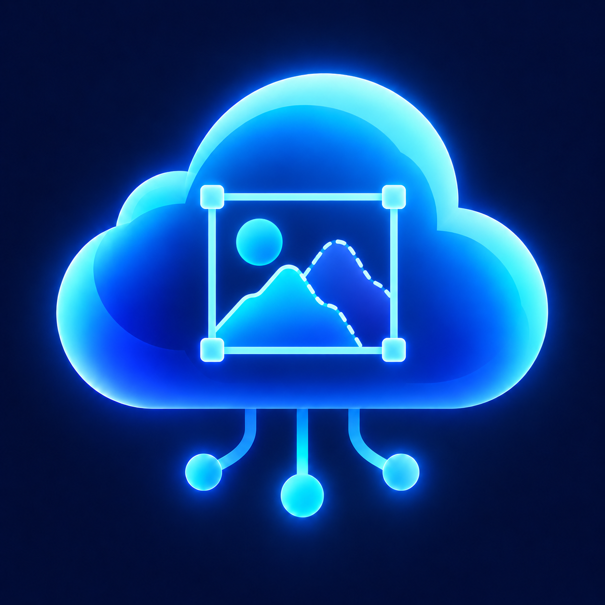
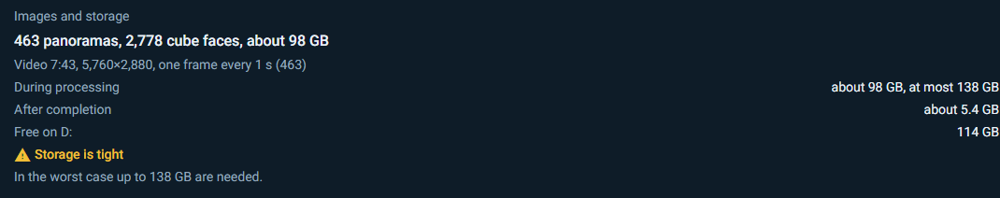

# SAMcloud



SAMcloud is a local photogrammetry application. It reconstructs 3D point
clouds from drone, standard-camera, and 360 degree Insta360 imagery with
COLMAP. It then assigns semantic LAS classes with SAM3 and checks every class
geometrically. Indoor scans get a metric scale from printed AprilTags, objects
get instance IDs, and classified clouds can be turned into clean 2D CAD plans
(DXF) and, for indoor scans, an IFC4 building model. The project was developed for the Digital Twin Programming module at
HSLU.

## Examples

Worked examples per capture type, each on its own page:

| Capture type | Example | Status |
|---|---|---|
| 360 degree camera, indoor | [360 degree indoor](docs/examples/indoor_360.md) | complete: apartment `test_home_v13_tag`, from input to DXF and IFC - [open the result online](https://pub-c77fc3c3582246af9ffef1b9e877a798.r2.dev/share/indoor-360-example/index.html) |
| 360 degree camera, outdoor | [360 degree outdoor](docs/examples/outdoor_360.md) | capture guide; example results follow |
| Drone GPS/RTK | [Drone photos](docs/examples/drone.md) | capture guide; example results follow |
| Standard camera | [Phone video and handheld photos](docs/examples/phone.md) | complete: bedroom `test_handy_video_1tag_v2` (phone video, one AprilTag), from input to DXF and IFC - [open the result online](https://pub-c77fc3c3582246af9ffef1b9e877a798.r2.dev/share/phone-video-example/index.html) |

Each page shows the full workflow for that capture type, from input to classified point cloud and DXF plan.

## Contents

1. [Examples](#examples)
2. [Overview](#overview)
3. [Processing pipeline](#processing-pipeline)
4. [Semantic classification](#semantic-classification)
5. [Targets, scale, and control points](#targets-scale-and-control-points)
6. [LAS export and coordinate systems](#las-export-and-coordinate-systems)
7. [DXF export](#dxf-export) (incl. [IFC export](#ifc-export))
8. [User interface](#user-interface) (incl. [sharing by QR code](#sharing-by-qr-code))
9. [Capture types, processing modes, and coordinates](#capture-types-processing-modes-and-coordinates)
10. [Architecture](#architecture)
11. [Configuration](#configuration)
12. [Project files](#project-files)
13. [Installation and start on Windows](#installation-and-start-on-windows)
14. [Tests](#tests) (incl. [synthetic indoor bench](#synthetic-indoor-bench))
15. [Scope and independent work](#scope-and-independent-work)
16. [Author and license](#author-and-license)

Further documentation in [`docs/`](docs/):

- [Architecture](docs/architecture.md): packages, data flow, subprocess model
- [Configuration reference](docs/configuration.md): every `config/` file
- [AprilTag scale and georeferencing](docs/apriltag_scale.md)
- [Object instances](docs/instances.md): per-point `instance_id`
- [Orthophoto clean plan](docs/ortho_plan.md): true orthophoto to clean DXF
- [IFC export](docs/ifc_export.md): IFC4 model, 3D opening refinement, IFC viewer
- [Cyclone 3DR classes](docs/cyclone_classes.md): LAS codes and DXF layers
- [UI language](docs/i18n.md): German/English interface, translation files
- [Processing report](docs/protocol.md): per-project PDF with key figures, control-point accuracy and runtimes

## Overview

SAMcloud provides a guided workflow comparable to common photogrammetry
applications:

1. Select images.
2. Align the cameras (indoor projects scale the model from AprilTags).
3. Optionally define ground control points, manually or automatically.
4. Generate a dense point cloud.
5. Classify it semantically.
6. Improve and filter the cloud.
7. Export a reusable LAS file and, optionally, DXF plans.

Every job is stored as a reopenable local project. Source images stay at their
original location.

Main features:

- **Reconstruction** with COLMAP 4.2.0 (CUDA): sparse model, GPS/RTK alignment,
  dense stereo, and fusion.
- **Semantic classification** with SAM3 and the SegEarth-OV3 method: three SAM3
  heads are fused and the results are voted across all camera views. Outdoor
  projects can use **FlurSeg** instead, the project's own segmentation model
  (about 15x faster, fixed classes). SAM3 projects can edit and extend their
  classes when the project is created.
- **Geometric refinement:** height above ground, flatness, and neighbourhood
  checks. They use the SAM3 confidence, for example to turn flat roofs that
  SAM3 labels as ground into building.
- **Indoor clean-up:** floating points, mirror phantoms and gaps are handled in
  workflow step 6 (Depth-Anything-V2 prior, TSDF surface fusion, superpoint
  vote); curtains are suppressed to Unknown.
- **AprilTags and control points:** printable 150 mm AprilTags give indoor
  models their metric scale, and with surveyed centres a full georeference.
  Outdoors, printable cross targets are detected automatically and reviewed on
  the sparse page (see [Targets, scale, and control points](#targets-scale-and-control-points)).
- **Object instances:** SAM3 instance masks become a per-point `instance_id`
  (furniture, doors, windows, fixtures, vehicles, trees, ...). Clicking an
  object in the viewer highlights it; the LAS and the DXF carry the IDs
  ([docs/instances.md](docs/instances.md)).
- **Review before export:** a built-in 3D viewer (Potree when installed, a
  canvas preview otherwise) shows the RGB and class views and can show or hide
  individual classes. The LAS export (Cyclone 3DR / ASPRS LAS 1.4 codes) is
  started manually.
- **DXF plans:** a fast point-cloud plan and a clean plan from a true
  orthophoto, per storey (indoor) or as a site plan (outdoor). Indoor clean
  plans have double-line walls with measured or learned thickness, rooms
  bounded by the walls with name and area, slanted walls, and regularised
  furniture; kitchens get their measured diagonal corner, U shape, peninsula
  and bar. A 3D DXF is written next to the 2D plan, see
  [DXF export](#dxf-export) and [docs/ortho_plan.md](docs/ortho_plan.md).
- **IFC4 building model (indoor):** the same button that makes the DXF also
  writes an IFC4 file from the same building model (`plan_model.json`), so
  walls, rooms, doors and windows match the DXF. Windows and doors are
  measured on the wall planes from the photos and the cloud (sill, head,
  mullions; implausible slivers and glass partitions are not taken as
  windows). Furniture gets a 3D shape from its points; screens (TV and
  monitors from the SAM3 masks), ceiling
  objects, columns, beams, straight stairs and measured wall and ceiling
  heights are added where the scan gives evidence. An IFC viewer on the DXF
  page shows the result, see [IFC export](#ifc-export) and
  [docs/ifc_export.md](docs/ifc_export.md).
- **Storage check:** the create-project form shows the image count, the
  estimated storage and the free space before anything is processed.
- **Sharing by QR code:** a point cloud, or a whole project with plan, cloud
  and IFC model, can be published as a web view in your own Cloudflare R2
  bucket, see [Sharing by QR code](#sharing-by-qr-code).
- **German and English UI:** the interface is German by default and can be
  switched to English in the settings; project files, reports and exports do
  not depend on the language ([docs/i18n.md](docs/i18n.md)).

## Processing pipeline

A full run executes the following stages in order
(`samcloud/engine/pipeline.py`). Progress and stage durations are shown on the
dashboard and written to `reports/`.

| # | Stage | Tool | Result |
|---|---|---|---|
| 1 | Feature extraction | COLMAP | image features in `database.db` |
| 2 | Image matching | COLMAP | feature matches |
| 3 | Sparse reconstruction | COLMAP mapper | camera poses and sparse cloud (`products/sparse/0`) |
| 4 | GPS alignment (drone GPS/RTK only) | COLMAP `model_aligner`, ENU | georeferenced model (`products/sparse/0_geo`), metres, z up |
| – | *AprilTag scale or georeference (when enabled, non-GPS projects)* | OpenCV ArUco `tag36h11`, pycolmap | scaled (`products/sparse/0_tagscale`) or georeferenced model, `reports/apriltag_report.json` |
| 5 | Dense preparation (undistortion) | COLMAP | undistorted images and PINHOLE TXT model in `products/dense/` |
| – | *Optional pause for control points* | SAMcloud UI | control point observations; GCP georeferencing is applied on resume |
| 6 | Dense stereo, fusion | COLMAP | `products/dense/fused.ply` and visibility file `fused.ply.vis` |
| 7 | Classification | Ultralytics SAM3 or FlurSeg (outdoor) | `classified_raw.ply`, `classified_scores.npz` |
| 8 | Improve & filter (workflow step 6, see below) | Depth-Anything-V2, depth maps, SAM labels | cleaned `classified_raw.ply` |
| 9 | Geometric refinement (part of step 6) | `samcloud/engine/geometry` | `classified.ply`, `reports/geometry_summary.json` |
| 10 | LAS export (manual, workflow step 7) | laspy, PyProj | LAS 1.4 with CRS WKT, class mapping, and CRS-appropriate scale |
| 11 | DXF export (optional, manual) | ezdxf, orthophoto jobs | per-storey or site DXF files, see [DXF export](#dxf-export) |

Classification (stage 7) also writes the per-point fine terms and the object
`instance_id` (see [Object instances](#object-instances)). The dashboard shows
the workflow steps imagery, alignment, control points, dense cloud, SAM3,
**improve & filter**, LAS/PLY export and DXF export, each with its own progress
and remaining time. Remaining times are learned separately per capture type
(drone, camera, 360°) in `projects/.samcloud_stage_rates.json`, so 360 runs
never distort the drone estimate.

### Improve & filter (step 6)

COLMAP's depth maps (and indoors the Depth-Anything-V2 depth) are kept until
this step has finished. The stages run in this order
(`_refine_after_classification` in `samcloud/engine/pipeline.py`); the
indoor-only ones are skipped for the outdoor class set:

1. **Depth-Anything-V2 prior (indoor only).** A metric indoor depth is predicted
   for every dense view and aligned to COLMAP's own depth map per view
   (`colmap ≈ scale·DA + shift`, robust fit). Views without enough COLMAP depth
   (white walls) use the median fit of all good views, unless that contradicts
   the COLMAP pixels they do have (`samcloud/colmap/depth_prior.py`).
2. **Mirror detection (indoor only).** Planar mirrors are detected from SAM
   masks (the `mirror` prompts in `config/classes.json`) and the reflected
   phantom geometry behind them is removed
   (`samcloud/colmap/mirror_filter.py`).
3. **Depth fill or surface fusion (indoor only).** With the default
   `surface_fusion.mode: snap`, all depth maps go into one truncated signed
   distance field on the GPU. COLMAP depth weighs more; Depth-Anything only adds
   depth where it agrees with COLMAP. Space a camera looks through is carved
   empty, points are snapped onto the merged floor, ceiling and wall planes
   (one ceiling height, building axes only), and a GPU visibility check removes
   points that cameras look through. A depth-edge filter, a haze filter, and
   view-count checks for wall planes and points remove walls behind walls
   (`samcloud/colmap/surface_fusion.py`); the optional hidden-point and
   behind-wall filters are off by default.
   Surface fusion can be switched off per project; then the Depth-Anything
   depth fill (`depth_fill.py`: confirmed by several views, local alignment
   against COLMAP and sparse points) runs instead. In `extract` mode the cloud
   is rebuilt from the fused surface.
4. **Floating points removed (all capture types).** A point is removed when at
   least three cameras reliably measure a surface *behind* it and they
   outnumber the cameras that measure the point itself
   (`samcloud/colmap/point_cleaning.py`). Indoors with surface fusion this is
   done by the fusion's visibility check instead.
5. **Plane grid fill.** Off by default (`plane_fill.enabled: false`); it fills
   gaps inside fitted planes and looked artificial in tests
   (`samcloud/colmap/plane_fill.py`).
6. **Superpoint vote (indoor only).** Geometry and colour form superpoints;
   broad classes (wall, ceiling, floor, door, window, furniture, unknown,
   construction material) are decided by the majority inside a superpoint,
   while fine classes stay protected (`samcloud/colmap/superpoint_vote.py`).
7. **Geometric refinement** as described below (outdoor, georeferenced).

Settings live in `config/colmap.yml` (`point_cleaning`, `depth_fill`,
`surface_fusion`, `superpoint_vote`, `plane_fill`, with a separate profile per
capture type under `capture_profiles`) and on the project settings page (depth
model Large / Small / Off, surface fusion on/off). `config/colmap.yml` also
sets `window_step: 2` for the 360 profile, which makes PatchMatch about 2x
faster.

## Semantic classification

### Classes

The classes follow the Nomivox preset [Nomivox Github](https://github.com/AIhdproduction/Nomivox) (`presets/default.json`) and are stored
in `config/classes.json`: per class set the class order, the prompt list of
every class, its LAS code, colour and German label. ID 0 is always
*Unknown/noise* (LAS code 1, unclassified). Indoor uses the Nomivox classes of
scene `indoor` or `both`, outdoor those of scene `outdoor` or `both`.

| Class set | Classes |
|---|---|
| `outdoor` (23) | ground, road, sidewalk, curb, low vegetation, tree, building, vehicle, construction machinery, utility pole, traffic sign, fence, outdoor wall, power line, construction material, water, window, stairs, column, beam, steel structure, manhole, tree trunk |
| `indoor` (19) | construction material, wall, ceiling, floor, door, window, stairs, railing, column, beam, steel structure, pipe, cable, electrical, HVAC, ceiling equipment, furniture, appliances, sanitary fixtures |

Every prompt is sent to SAM3 on its own and a class keeps the best of its
prompts. Synonyms must never be joined into one long comma-separated prompt:
that drives SAM3's presence score towards zero (walls and ceilings were lost).
The image backbone runs once per tile and the prompts run in batches of 8
(larger batches overflow 24 GB of VRAM on 3200 px drone photos and get about 10x slower).
Indoor curtains are not a class: the `suppress` prompts in `config/classes.json`
are added to SAM3 at run time, and points where they win become
Unknown/noise (`classified_scores.npz` stores a `suppressed` flag so the
superpoint vote never relabels them). The `mirror` prompts feed the mirror
detection of step 6.
To update the classes from a newer Nomivox preset:

```bat
venv\Scripts\python -m samcloud.tools.import_nomivox_classes <nomivox-folder>\presets\default.json
```

### Own classes per project (SAM3)

When creating a project with SAM3 (outdoor, and always for indoor), the panel
**Klassen anpassen (SAM3)** lets you change the prompts of every standard class
and add own classes (English name, German label, prompts, colour). The project
then gets its own `config/classes.json`, which the pipeline, the LAS export and
the dense viewer use instead of the global file. Standard classes keep their ids
and names (step 6 and the geometry rules use them); own classes are appended and
get free LAS codes from 64.

### FlurSeg (outdoor alternative to SAM3)

The trained model is available on [Hugging Face](https://huggingface.co/AIhdproduction/Flurseg). Use it for outdoor projects to classify about 15x faster than SAM3 (~2 s vs ~30 s per photo; 18.5 min vs ~2.5 h for a full run). Its 11 FlurSeg classes are fixed and cannot be customised.

FlurSeg is an EoMT-DINOv3-L model trained on SAM3 pseudo-labels with 11 classes:
other, ground, paved surface, low vegetation, tree, building, vehicle,
construction, curb, road marking and utility cover. `config/flurseg.yml` maps them
to the SAMcloud outdoor classes (paved surface and road marking to road,
construction to construction machinery, utility cover to manhole, other to
unknown). Inference uses a 768 px sliding window (stride 384) in fp16; the
multi-view voting, step 6 and geometric refinement are the same as for SAM3.
Its classes are fixed by the training and cannot be customised.

#### Download and install the model

The model is published at [https://huggingface.co/AIhdproduction/Flurseg](https://huggingface.co/AIhdproduction/Flurseg). The repository provides two versions in separate subfolders as well as an `evaluation/` folder with metrics and comparison panels:

- `v1/`: **recommended**, trained on SAM 3 pseudo-labels that were manually reviewed and refined.
- `v2/`: experimental self-training round, not better than v1 on the independent test.

Each version folder contains `config.json`, `model.safetensors`, and `preprocessor_config.json` (plus `classes.yaml`, `summary.json`, `train.log`, `train_config.yaml`, and `README.md`).

SAMcloud loads the model from the folder set in `config/flurseg.yml` under `model.directory`. A relative path is resolved against the SAMcloud root (the current default is `models/flurseg_eomt_dinov3l_20261107-211214/best`). That folder must directly contain `config.json`, `model.safetensors`, and `preprocessor_config.json`. Note that `models/` is not part of the git repository.

1. **Download the model:** The `huggingface_hub` package is installed in the venv, so the `hf` CLI is available. Run from the SAMcloud root:
   ```bash
   venv\Scripts\hf download AIhdproduction/Flurseg --include "v1/*" --local-dir models/flurseg
   ```
   Alternatively, download manually from the website ("Files and versions") using the same folder layout.
2. **Resulting folder layout:** This creates `models/flurseg/v1` directly containing the required files:
   ```text
   models/flurseg/v1/
   ├── config.json
   ├── model.safetensors
   └── preprocessor_config.json
   ```
3. **Configure the path:** Set `model.directory` in `config/flurseg.yml`:
   ```yaml
   model:
     directory: models/flurseg/v1
   ```
4. **Select FlurSeg:** Choose FlurSeg as the classification engine in the project settings or dashboard when configuring an outdoor project.

If any required model file is missing from that directory, the run reports `FlurSeg model file missing: <path>`. The weights are based on DINOv3; see `LICENSE` and `NOTICE.md` in the Hugging Face repo for the license.

Grütistrasse test (291 drone photos, same dense cloud with 65 M points, SAM3 as
reference):

| | SAM3 | FlurSeg |
|---|---|---|
| Classification per photo | ~30 s | ~2 s |
| Full run incl. step 6 and geometry | ~2.5 h | 18.5 min |
| Agreement with SAM3 (FlurSeg's 11-class taxonomy) | – | 93 %, kappa 0.88 |

Ground, low vegetation, vehicle, paved surface and building agree closely
(IoU 0.79–0.98). Tree, manhole, construction and curb are weaker, and FlurSeg
cannot separate sidewalk from road or detect fences, poles, signs, walls and
other fine classes. The model is not part of the repository; see *Download and install the model* above.

The dashboard button **Klassifizierung neu rechnen** (pipeline `--reclassify`)
re-runs only classification, step 6 and geometry on the kept dense cloud, so
SAM3 and FlurSeg can be compared on exactly the same points.
If the dense inputs are only left in the processing cache, they are hard-linked
into a `reclassify_staging_<id>` folder inside the project, which stays there
after the run; where linking is impossible they are copied, and only when they
fit on the drive. The cache keeps the previous classes, so recomputing step 6
from it is refused after a reclassification.

More prompts cost time: indoor 360 runs take about 2 s per cubemap face
(one SAM pass per 1024 px face); large drone photos are tiled and take longer.

### Step 1: SAM3 per image (SegEarth-OV3)

The method follows *SegEarth-OV3: Exploring SAM 3 for Open-Vocabulary
Semantic Segmentation in Remote Sensing Images* (arXiv:2512.08730). It is
implemented in `samcloud/engine/sam_labeler.py`.

1. **Tiling:** every undistorted image is split into evenly spaced tiles
   (768, 1008, or 1280 px, overlap at least 0.2) so thin structures are not lost.
2. **Raw heads:** SAM3 runs once per tile with all class prompts. SAMcloud reads
   the three heads separately instead of the final masks:
   - presence score S_pres per class
   - semantic map P_sem
   - instance masks P_inst with confidence s_conf
3. **Instance aggregation:** for each class and pixel,
   `P_inst_agg = max_k(P_inst_k · s_conf_k)`. Only queries with
   `s_conf ≥ query_threshold` (0.4) count.
4. **Dual-head fusion:** `P_fused = max(P_sem, P_inst_agg)`. The instance head
   gives sharp edges on objects, and the semantic head gives continuous surfaces
   such as ground and vegetation.
5. **Presence gate:** `P_final = P_fused · S_pres`. Classes that SAM3 considers
   absent from the image are suppressed.

### Step 2: Multi-view voting in 3D

`samcloud/engine/classify.py` projects each dense point into every camera in
which COLMAP marks it visible (`fused.ply.vis`, occlusion-aware). The per-class
`P_final` values of these views are summed.

- A view whose best class is below `background_threshold` (0.4) counts as
  background and does not vote.
- The class with the largest sum wins. Points with fewer than `min_votes`
  voting views stay unknown.
- For every point, the confidence is saved in `classified_scores.npz`. It is
  the mean `P_final` of the winning class over the voting views, stored
  together with the second-best class and its confidence.

### Step 3: Geometric refinement

`samcloud/engine/geometry/` checks every point against geometric rules for its
class and corrects implausible labels.

**When it runs:**

- Only for georeferenced outdoor projects (local ENU coordinates in metres,
  z up).
- Otherwise it is skipped and the reason is recorded in the summary.

**Measurements per point:**

| Measurement | Meaning | Module |
|---|---|---|
| Height above ground (HAG) | distance to a robust terrain raster. The raster uses 1 m cells, a low percentile, and only ground-class points with SAM3 confidence ≥ 0.5. Elevated plateaus narrower than 40 m are removed. | `terrain.py` |
| Height above local support (HLS) | height above the nearest horizontal surface; on a roof this is the roof surface | `support.py` |
| Normal, planarity, roughness, linearity | local shape in 0.5 m voxels: 1 = horizontal and 0 = vertical, how planar, how thick, how line-like | `features.py` |
| Neighbour classes | class counts of valid points in the surrounding voxels | `neighbors.py` |

**Order of the checks** (`refine.py`):

1. **Flat roofs** (`rules/building.py`): a point labelled ground, road,
   sidewalk, curb, or water that is flat (normal ≥ 0.9) and planar (≥ 0.3)
   becomes building in two cases:
   - it lies at least **5 m** above ground (geometry always wins);
   - it lies **2.5–5 m** above ground and SAM3's confidence is below 0.6
     (otherwise the SAM3 label is kept).
2. **Rule per class:** each class has its own file in `geometry/rules/`.
   Points with SAM3 confidence ≥ 0.85 are protected from these rules.

   | Class | A point passes if |
   |---|---|
   | ground | HAG ≤ 1.0 m |
   | road | HAG ≤ 0.5 m, horizontal (normal ≥ 0.85), smooth (roughness ≤ 0.15 m) |
   | sidewalk | HAG ≤ 0.6 m, horizontal, smooth |
   | curb | HAG ≤ 0.6 m and directly next to road or sidewalk |
   | water | HAG ≤ 0.5 m, very horizontal (normal ≥ 0.9) |
   | low vegetation | HAG ≤ 2.0 m or HLS ≤ 2.0 m (vegetation on roofs stays vegetation) |
   | tree | HAG ≥ 2.0 m |
   | building | HAG ≥ 2.0 m, or a vertical wall ≥ 0.3 m (facades and retaining walls) |
   | fence | HAG ≤ 3.0 m or HLS ≤ 3.0 m (railings on roofs stay fence) |
   | overhead power line | HAG ≥ 3.0 m and not planar (planarity ≤ 0.4) |
   | vehicle | HAG ≤ 4.5 m |
   | traffic sign | HAG ≤ 6 m |
   | construction container | HAG ≤ 6 m |
   | construction machinery | HAG ≤ 10 m |
   | utility pole, scaffolding | no rule |

3. **Reassignment** of points that fail their rule, in this order:
   1. SAM3's second-best class, if its confidence is ≥ 0.2 and its rule passes;
   2. the most frequent valid neighbour class whose rule passes;
   3. unknown.

**Outputs and tuning:**

- `classified.ply`: refined result, shown in the viewer and used for export.
- `classified_raw.ply`: result before refinement, kept for comparison.
- `classified_scores.npz`: SAM3 confidence and second-best class per point.
- `reports/geometry_summary.json`: roof conversions, failures per class, how
  points were reassigned, top class changes, and confidence percentiles per
  class.

All thresholds are in `config/geometry.yml`. After changing them, only the
refinement has to be repeated. This takes about two minutes and does not rerun
SAM3:

```bat
venv\Scripts\python samcloud\engine\geometry\refine.py --input <classified_raw.ply> --output <classified.ply> --classes-json config\classes.json --class-set outdoor --scores <classified_scores.npz> --summary-file <reports\geometry_summary.json>
```

### Object instances

SAM3's instance head also yields object masks. With `classification.instances.enabled`
(default on, `--no-instances` on the pipeline) every dense point of an
*instance class* gets an `instance_id` (0 = none): indoor furniture,
appliances, sanitary fixtures, doors, windows, HVAC, electrical, columns and
ceiling equipment; outdoor vehicles, construction machinery, trees, tree trunks, utility poles,
traffic signs, manholes and columns (`instance_classes` in `config/classes.json`).
Walls, floors and ceilings never get one. Per-view masks are associated in 3D,
then merged by label aliases (for example "casement window" to window),
soft furnishing is absorbed into its bed or sofa, and each object grows over
connected points of its class by at most 0.6 m (`samcloud/engine/instances.py`).
Screens and ceiling equipment form a secondary layer that is associated on its
own and only takes points the other objects left free.
The result is `instance_id` in `classified.ply`, the sidecar
`products/classified/instances.json` (label, class, point count, bounding box,
views, confidence), an `instance_id` extra dimension in the exported LAS, and
object labels in the DXF plans. In the viewer a click opens a card with the
German object name and highlights the whole object. AprilTag squares never
belong to an instance. Details: [docs/instances.md](docs/instances.md).

## Targets, scale, and control points

Metric scale and georeferencing come from one of four sources.

| Source | Capture types | Result |
|---|---|---|
| Image GPS/RTK | drone | automatic georeference (see below) |
| Manual control points | all | georeference from three or more marked points |
| Automatic control points | drone with GPS/RTK and a point list | cross targets are detected, a GCP bundle adjustment runs, and a quality gate decides whether review is needed |
| AprilTags | indoor, non-GPS | scale from tag size, optionally georeference from surveyed tag centres |

**AprilTags (indoor scale).** The AprilTag switch in the project dialog is on
by default for Indoor and off for Outdoor. Print `tag36h11` tags (IDs 0 to 586) on the
**Targets** page: one A4 page per tag with a black square of exactly 150 mm
(print at 100 %), the ID, edge-midpoint ticks that mark the tag centre, and a
100 mm check bar. Tags are detected with OpenCV ArUco in the COLMAP input images (for 360
projects, the cubemap faces) and triangulated from at least two images. Scale works from a single tag; with fewer than three tags the report
warns that no cross-check is possible, and outliers beyond `apriltags.outlier_pct`
(3 %) are ignored. With at least three non-collinear tags that have surveyed
coordinates (`control_points/apriltags.csv`, columns `id,x,y,z[,role]`, entered
on the Control points page or uploaded in the project dialog), the tags act as
control points and give a full georeference; the tag CRS can also be `LOCAL`
for a private metric survey system. See
[docs/apriltag_scale.md](docs/apriltag_scale.md).

**Cross targets (outdoor).** The Targets page also prints numbered 180 mm cross
targets (two black triangles on white paper, tips meeting at the survey
point). The automatic detector (`samcloud/control_points/targets.py`, polarity
`auto`) finds such bow-tie targets sub-pixel in the images. Note that the
black printed variant is only reliably detected on light ground.

**Automatic control points** (settings page, mode *Automatic*): detected
targets feed a GCP bundle adjustment (points with role `pass` are held as
constants, points with role `control` are only checked, and the loss is
trivial so outliers stay visible). Results show
in the review workspace on the Sparse page: a marker table with 3D and pixel
errors, a photo strip filtered by marker, and a pixel-level viewer for
correcting observations, plus **Optimize** and **Continue processing**. A point
that cannot be detected stays unrecognised and can be marked by hand.

## LAS export and coordinate systems

The LAS exporter writes point format 7, LAS 1.4, the output CRS as WKT, and a
VLR containing the semantic class mapping. It uses millimetre scales for local
and projected coordinates, and `1e-7` degree horizontal scales for geographic
coordinates. When the classified cloud carries them, the LAS also gets two
extra dimensions: `fine_term` (uint8, fine SAM term id, vocabulary in
`fine_labels.json`) and `instance_id` (uint32, see
[Object instances](#object-instances)). A `*.las.profile.json` sidecar records
the model profile for the DXF page.

| Key | What you get | Requirements |
|---|---|---|
| `LOCAL` | Reconstructed local x/y/z coordinates | Available for every project. |
| `EPSG:4326` | WGS84 longitude/latitude and ellipsoidal height | Drone GPS/RTK project (automatic georeference). |
| `EPSG:2056` | Swiss LV95 x/y and LN02 height | Drone GPS/RTK project (automatic georeference), plus the swisstopo CHGeo2004 grid. |

For drone GPS/RTK projects, SAMcloud fits a 7-parameter similarity from COLMAP's
ENU frame to ECEF using the camera centres, then transforms the result with
PROJ. The fit residuals are reported in the export log and in
`products/georeference.json`. RTK coordinates are treated as ETRS89, which is
equivalent to WGS84 for this purpose, and DJI metadata heights are treated as
ellipsoidal. LV95 exports convert height to LN02 with the swisstopo CHGeo2004
geoid. This path was validated against swisstopo REFRAME: 1 mm horizontal and
3–5 mm LN02 height.

Projects with at least three usable ground control points can also be
georeferenced. Import `name,x,y,z`, normally in LV95 + LN02
(`EPSG:2056+5728`), then mark every point in at least two undistorted images.
SAMcloud triangulates the clicks, fits a similarity into a local ENU frame at
the GCP centroid, and records per-point and leave-one-out residuals in
`reports/control_points_report.json`. For drone projects, GCPs take precedence
over GPS; the GPS camera-centre residual remains in that report for comparison.
Use **Check control points** to inspect these residuals before selecting
**Continue processing** and starting the dense stages.

To add another CRS, edit `config/export_crs.yml`, add its PROJ-readable target,
and list every required geoid or transformation grid. Install those grids
yourself into the PyProj data directory, then restart SAMcloud. The exporter
never uses approximate, ballpark transformations.

## DXF export

The optional **DXF** page (`/dxf`, also reachable from the "DXF export (optional)"
step on the overview) turns a classified LAS file into 2D CAD plans: one DXF per
storey for indoor projects, one site plan for outdoor projects. Nothing on this
page runs by itself. Opening the page, switching level or changing a setting
only reads cached results from `products/dxf/`; every heavy step starts with a
button and runs as a background job (`python -m samcloud.dxf.jobs …`) with a
progress bar and **Cancel**. A cancelled or failed job keeps the previous cache
and shows the end of `products/dxf/job.log`. Only one DXF job runs per project.

**Automatic DXF/IFC (workflow step 8).** After a successful processing run
(steps 1 to 6) the DXF and, for indoor projects, IFC export is created
automatically as a separate final stage: the same jobs as **Compute everything**,
once per detected storey (once for the site outdoors). A failure of this stage
never fails the processing run; it is shown as step 8 "failed" and as a warning
in `reports/run_summary.txt` (details in `reports/auto_dxf.json`). Turn it off
with **Create DXF/IFC automatically after processing** (project creation or
Settings, key `workflow.auto_dxf`, default on). For a finished project run it by
hand with `python -m samcloud.engine.auto_dxf --project <project directory>`.
After a processing run, outdoor projects run the environment chain
(`samcloud/drone/run_environment.py`) at this stage instead of these jobs.
FlurSeg projects deliver point clouds only: they get no DXF or IFC.

### Plan variants

The DXF page offers two plan variants (selector **Plan variant**):

- **Point cloud (fast):** layers are cut directly from the classified cloud
  (steps below).
- **Orthophoto (clean):** a true orthophoto, a semantic segmentation of it, and
  a height raster are turned into a cleaner CAD plan: straightened walls,
  catalogue blocks for doors, windows and fixtures, room names and, outdoors,
  contours and spot heights. Each stage has its own button and cache (**Build
  orthophoto**, **Segment**, **Generate clean plan**, **Export DXF**), and
  **Compute everything** runs all stages for the selected level or site (indoor: including **Refine openings** and the IFC export, see [IFC export](#ifc-export)).
  Clean exports are named `<project>_<level>_clean.dxf`. **Compare plans**
  overlays both variants. See [docs/ortho_plan.md](docs/ortho_plan.md).

Indoor clean plans draw every wall with **both faces** as a closed outline on
`A-WALL`, filled with a solid hatch on `A-WALL-PATT`. Where both faces were
seen, the distance between them is the wall thickness; a face that was not
seen is inferred from the learned thickness classes (or the configured
exterior thickness), so it still runs straight and parallel. Door and window
openings are cut through both faces. Rooms (`A-AREA` with name and area) are
the floor between the walls, split only by walls and door lines (each room
goes to the middle of its doors, a passage without a door does not split), so
their outlines follow the inner wall faces and never stop at furniture; rooms
never overlap, a measured wall ledge ends a room, and a small "bed" outline
names no bedroom; an
open-plan space with no wall or door between its parts is one room (for
example "Wohnen / Küche"). Furniture outlines are regularised to rectangles
or rectilinear shapes along the wall axes, cut back at walls and overlaps,
and labelled inside their room; texts are written after the fills, so no
hatch covers them. Details:
[docs/ortho_plan.md](docs/ortho_plan.md#double-line-walls).

Indoor clean plans also contain, where the scan gives evidence for it:

- **slanted walls** next to the two main wall directions, and walls placed on
  both scanned faces; the wall above an opening has the faces of its wall;
- **kitchens** with a diagonal corner unit at its measured angle, a sink turned
  with it, a base that steps back under its worktop, a U shape, a peninsula
  with a bar top, a tall row and upper cabinets (one piece per row);
- **columns** (`A-COLS`) and **beams** (`S-BEAM`, dashed);
- **furniture symbols** that draw chairs, pillows and sets only where they
  were detected, and tables at their measured size;
- **objects on the ceiling** (`A-CLNG-OBJ`, dashed) and furniture outlines
  taken from the 3D reconstruction. These two are written at export, so they
  are in the DXF file but not in the preview on the page.

**3D DXF.** The IFC step also writes `<project>_<level>_3d.dxf` to
`products/dxf/export/`: the IFC elements as meshes in metres, one layer per
IFC class (`3D-IfcWall`, `3D-IfcFurniture`, ...), without spaces and opening
voids. It uses the IFC coordinates.

**Scale.** A cloud with metric evidence (AprilTag scale, georeference, control
points, GPS/RTK or a scale set on the DXF page) is exported in true metres
(`clean_plan.metric_scale` in `config/ortho_plan.yaml`, default on). Only a
cloud without such evidence is scaled from the storey height (2.5 m nominal).
`plan_model.json` records the reason in `source.scale_source`; the scale line
on the DXF page shows only a factor set on that page.

Instance labels from `instances.json` (for example *Sofa*, *Tisch*) are written
as text and block attributes in both variants when the classified cloud has
instance IDs.

### Workflow

1. **LAS file and profile.** The page uses `products/classified/classified.las`
   by default; any other uncompressed `.las` file (for example scanner data) can
   be entered instead. The model profile and indoor/outdoor mode come from the
   LAS sidecar (`*.las.profile.json`) or its `colmap_sam` VLR. A LAS without
   provenance must get a profile first (`sam3_outdoor`, `sam3_indoor`,
   `flurseg_v1`, `legacy_v1`); the page is blocked until one is chosen. FlurSeg
   is outdoor only, so `flurseg_v1` with indoor mode is blocked with a message.
2. **Create preview.** Builds a voxel preview (`preview.npz`) and LAS summary
   (`las_info.json`) and lists plausibility warnings, for example an implausible
   extent that hints at a missing metric scale.
3. **Scale.** Type a factor and press **Apply**, or use the **Measure** tool in
   the side view or the DXF review: click two points, type the real distance,
   and SAMcloud computes the factor. Stored level heights are rescaled with it.
4. **Align to gravity** (indoor). Estimates tilt from the floor plane and,
   optionally, the yaw that puts walls on the X/Y axes (switch
   "Align walls to X/Y"). The rotation is stored per project and used by every
   later step.
5. **Detect levels** (indoor). Finds floors and ceilings. Levels are numbered
   from the bottom: the lowest level is `1`, then `2`, `3` and so on. Names can
   be edited; files are named `<project>_<level name>.dxf`.
6. **Side view** (indoor). **Render side view** draws the preview cloud from the
   side, coloured by class, along X or Y, optionally limited to a slab (centre
   and thickness) so rooms do not overlap. Level bands are shown on top: drag a
   floor (solid) or ceiling (dashed) line, add a level by clicking in
   "Add level" mode, rename, uncheck or delete levels in the list. Only checked
   levels are reviewed and exported.
7. **DXF review.** Pick a level (indoor) and press **Generate DXF preview**; the
   result is cached in `products/dxf/<level id>/` (`site/` outdoors). The canvas
   shows the cached top view (RGB or class colours) and the DXF vectors in the
   same coordinates: mouse wheel zooms at the cursor, drag pans, the cursor
   position is shown in metres, holding **H** hides the DXF layer. "Image
   opacity" and "DXF opacity" blend both layers (0–100 %). The layer list shows
   colour, entity count, visibility and why a layer is empty. Generation
   settings (cell size, per-layer mode and z band, wall centre-lines or polygons,
   door swing arc) are stored per project; changing them, the levels, the scale,
   the alignment or the profile marks the preview as out of date. It is never
   regenerated automatically. **Save snapshot PNG** writes the current view to
   `products/dxf/snapshots/`.
8. **Export.** **Export DXF** (or **Export all checked levels**) is enabled only
   for current previews. It writes R2018 DXF files in metres, in local or
   original coordinates, to `products/dxf/export/`, re-reads each file with the
   ezdxf auditor before it is moved into place, and shows the paths and audit
   result. Indoor exports are named `<project>_1.dxf`, `<project>_2.dxf`, …;
   outdoor exports `<project>_site.dxf`.

### Profiles and Cyclone codes

Classes are written with Cyclone 3DR classification codes (see
[`docs/cyclone_classes.md`](docs/cyclone_classes.md)); `config/dxf_layers.yaml`
maps codes to DXF layers. FlurSeg's road marking uses code 82, which Cyclone 3DR
lists as "Custom 82": rename that class to **Road marking** in Cyclone 3DR once.

### Known limits

- Wall thickness is measured only where both faces of a wall are seen;
  elsewhere it comes from the neighbouring room edge, the learned thickness
  classes or the configured exterior default (clean plan). The point-cloud
  plan estimates it from the points. Outer walls scanned only from inside
  normally get the default of 0.30 m.
- Objects and structure are modelled only with evidence from the points:
  small dark monitors, small ceiling fixtures and columns close to a wall can
  be missing, and only straight stairs are detected.
- Where a wall has almost no points, an opening in it can be modelled wrong:
  in the example the passage between hall and bedroom is about 0.7 m too wide.
  A few continuation walls can sit 3 to 5.5 cm off the scanned face, and a
  window head can be 5 to 9 cm off (evidence grid 5 cm).
- The indoor rules were developed on earlier recordings of one flat. The newest
  recording of that flat is the first independent test (see the
  [example](docs/examples/indoor_360.md)); there are no real data of other
  buildings yet, only a [synthetic bench](#synthetic-indoor-bench). Other
  buildings may need other thresholds.
- Door swing arcs are off by default.
- COLMAP reconstructions without GPS or control points have no metric scale;
  set the scale before generating plans.
- Only uncompressed LAS files are read; LAZ is not supported.

## IFC export

On indoor projects the DXF page is the **DXF/IFC** page. **Compute everything**
runs: orthophoto, segmentation, clean plan, **Refine openings**, clean plan
again (with the refined openings), DXF export and IFC export (with the 3D
DXF). One button therefore produces a 2D DXF, a 3D DXF and an IFC4 file. All
are written from the same building model, `plan_model.json` in `products/dxf/<level id>/ortho/`, so
walls, rooms, doors and windows are identical in the files.

- **Refine openings** measures every window and door on its wall plane
  (SAM3 window/door masks from the photos, projected with the COLMAP poses
  with occlusion test, plus evidence from the point cloud). It finds mullions,
  sill and head heights, and marks unobserved areas as unknown. The DXF window
  blocks carry the attributes `BRH` (sill), `STH` (head) and `MULLIONS`, doors
  `H` and `GLAZED`.
- The **IFC** has storey, walls with openings, doors, windows, rooms
  (`IfcSpace` with name and area), floor slab, ceilings (flat or sloped, per
  room), measured wall heights, columns, beams, straight stairs, furniture,
  screens and ceiling objects, and is checked against an IDS file with a QA
  report. It is written to `products/bim/<level id>/`.
- **Openings** pass plausibility rules (no slivers, no glass partitions as
  windows); a window head comes from the points when they clearly disagree with
  the photo.
- **Screens** (TV and monitors) are built from SAM3 masks and points; built-in
  units get readable names (*Hochschrank*, *Oberschrank*, *Einbauschrank*).
- **Furniture** is reconstructed from its points: parts such as table top and
  legs, seat and back, a compact mesh, or the footprint body when the evidence
  is weak (`config/furniture_recon.yaml`). Wall-hung and resting objects keep
  their measured bottom (`config/room_objects.yaml`).
- **QA** includes a check that the wall above and beside every opening is
  flush with its wall (5 mm); a step prevents "IFC4 OK".
- With more than one level a **combined IFC** is written to
  `products/bim/building/` when the levels share frame and scale. This is
  tested on synthetic data only.
- An **IFC viewer** below the DXF preview shows the model in 3D (element
  classes including ceiling objects and structure can be shown or hidden, click
  for properties, horizontal section) and offers the IFC download.

Details, outputs and the command line are in [docs/ifc_export.md](docs/ifc_export.md).

## User interface

The UI is built with NiceGUI and opens at `http://127.0.0.1:8080`.

| Page | Purpose |
|---|---|
| Overview | project dashboard: start processing, progress per stage (live frame progress in step 1, AprilTag count in step 3), manual LAS export, **Share project** by QR code |
| Projects | create, reopen, or delete projects; select images or 360 degree sources; image count and storage check before creation |
| Sparse cloud | inspect the aligned sparse model (cleaned for display only, `viewer.sparse_cleaning`), cameras, and the control point review workspace (marker table, photo strip, pixel viewer, **Optimize**, **Continue processing**) |
| Control points | import and mark ground control points in the images; AprilTag print dialog, surveyed tag coordinates (table, CSV import) and the AprilTag report |
| Targets | printable PDFs: AprilTags (150 mm, `tag36h11`) and numbered 180 mm cross targets; works without an open project |
| Dense cloud | 3D viewer of the classified cloud in RGB or class mode, with class filters and colours, a height filter, object click and highlight, AprilTag markers, and **Share (QR)** for the point cloud |
| DXF (indoor: DXF/IFC) | optional CAD export: preview, scale, alignment, levels, side view, DXF review, orthophoto clean plan, export, and the IFC viewer; hidden for FlurSeg projects |
| Settings | UI language (German/English), coordinate systems, GPU, capture options, control point mode, classification settings, Improve & filter switches |

**Storage check.** The create-project form shows the images found (for 360
degree sources: panoramas and cube faces), the storage needed during and after
processing, and the free space on the projects drive with a status (enough,
tight, not enough). It follows the paths, the frame interval and the storage
switches, warns about unusable sources, and suggests a longer interval when a
video does not fit. The numbers are estimates calibrated on one 360 degree and
one drone project (`samcloud/acquisition/preflight.py`); the check never
blocks creation.



**Language.** The interface is available in German (default) and English.
The default comes from `application.language` in `config/defaults.yml`; the
card *Sprache / Language* on the settings page overrides it for this
installation. The choice is saved immediately in
`.samcloud/user_preferences.json` (not under version control) and applies at
once: the settings page reloads in the new language and keeps unsaved inputs.
*Reset to configured default* removes the stored choice. Invalid values fall
back from the user choice to the configuration and then to German. Only
visible texts are translated: internal IDs, class codes, API fields, project
files, `progress.json`, and the DXF/LAS output stay the same in both languages;
class names are translated for display only. This documentation uses the
English UI names. Details: [docs/i18n.md](docs/i18n.md).

The sidebar footer lists the main components: COLMAP | SAM3 | FlurSeg |
Depth Anything.

The classification settings per project are:

- class set
- minimum voting images
- SAM3 tile size and overlap
- background threshold
- geometric refinement on/off (default on)

The dense and sparse viewers use **Potree 1.8** with PotreeConverter 2.x
(Poisson sampling, Brotli) when both are installed locally (`assets/potree/` and
`tools/PotreeConverter/`, see [Installation](#installation-and-start-on-windows));
the octree is built in the background and cached in `products/viewer/`. The
default point budget is 5 000 000 (`config/viewer.yml`). Points are drawn round, a
click on an instance shows its card and highlights the object (original colours,
bounding box), and a height filter hides points below or above a level. Without
Potree or the converter the viewer falls back to a downsampled canvas preview
of up to 300 000 points.

### Sharing by QR code

SAMcloud can publish a read-only web view and show a QR code and a link for it:

| Button | Where | Available when | Content |
|---|---|---|---|
| **Share (QR)** | Dense cloud | step 6 is finished | classified point cloud |
| **Share project** | Overview | classified cloud, a clean DXF export and an IFC model exist | one link with plan (DXF, top view), point cloud and IFC model, with all exported levels |

A project share of the indoor example is online:
[point cloud, DXF plan and IFC model](https://pub-c77fc3c3582246af9ffef1b9e877a798.r2.dev/share/indoor-360-example/index.html).

The files are uploaded to your own Cloudflare R2 bucket; a setup guide in the
app asks for the five values it needs and stores them outside the repository
(`share_credentials.yaml` in the user's application data folder). The cloud is
thinned to at most `max_points` (20 million). Before upload the package is
checked for photos and GPS files, and its text files for local paths (binary
files such as the 3D model are not searched). Links are set to expire after
15 days, which needs the bucket's deletion rule; they can be extended or
deleted in the dialog. Settings: `config/share.yaml`.

The pages offer no download, but this is no access protection: everyone who
has the link can reach the files behind it. Do not share interiors you are not
allowed to publish.

## Capture types, processing modes, and coordinates

**Capture types**

- **Drone GPS/RTK:** image GPS tags are used for the ENU alignment. This is the
  only type that is georeferenced automatically, so it is the only type that
  receives the geometric refinement without control points.
- **Standard camera:** the input is either photos or a video (one file or a folder
  of videos; the sharpest frame of each interval window is extracted, default 1 s).
  Reconstruction starts in `LOCAL`. `Indoor` projects without control points are
  levelled automatically from the camera up vectors and the floor plane, and the
  scale comes from AprilTags; `Outdoor` projects need control points for level and
  scale. Three or more marked GCPs georeference the model and enable geometric
  refinement for `Outdoor` projects. `Indoor` projects are georeferenced but not
  geometrically refined. If the mapper splits into several models, the largest one
  is used.
- **360 degree camera / Insta360:** export the footage from Insta360 Studio
  first. SAMcloud accepts stitched 2:1 equirectangular `.mp4` videos and `.jpg`
  panoramas, or both together; raw `.insv` files are not supported.
  - Choose `Indoor` or `Outdoor`. Three or more marked GCPs georeference the
    reconstruction and enable geometric refinement for `Outdoor` projects.
    `Indoor` projects are georeferenced but not geometrically refined.
  - Video frames are extracted once per second by default.
  - Each panorama is split into six perspective cubemap views for COLMAP.
  - Extracted frames, cubemap views, and a source manifest are stored below
    `inputs/`. Capture settings are locked once these derived inputs exist.

**Processing modes** (`workflow.control_points_mode`)

- `none` (default): alignment, dense reconstruction, classification, and
  refinement run without interruption.
- `after_alignment`: the run pauses after image undistortion and TEXT-model
  export, so points can be marked in the actual dense images. Use **Check
  control points** to review residuals and leave-one-out values, then select
  **Continue processing** after three usable points to resume without repeating
  feature extraction, matching, mapping, or undistortion.

- `automatic` (settings page, drone projects with GPS/RTK and a control point
  list): targets are detected automatically, a GCP bundle adjustment runs, and
  the run pauses for review only when the quality gate fails (see
  [Targets, scale, and control points](#targets-scale-and-control-points)).

AprilTags are independent of this mode: when enabled for a non-GPS project, the
tag step runs after alignment and before undistortion.

In all modes the classified PLY is produced first. The LAS export is a
separate manual action, so the result can be reviewed before export.

**Coordinate systems**

See [LAS export and coordinate systems](#las-export-and-coordinate-systems) for
the available export CRSs and how to configure additional ones. GCP-georeferenced
projects can export to the configured WGS84 and LV95 targets just like GPS projects.

## Architecture

```text
main.py                          entry point (NiceGUI, port 8080)
samcloud/
├── app/                         UI pages, layout, processing jobs, viewers, REST endpoints
│   ├── i18n.py                  UI translations: t(key, **params), translate_or, language choice
│   ├── locales/                 de/ and en/ translation files, one JSON file per namespace
│   └── pages/                   home, projects, sparse (+ GCP review), control points, targets,
│                                dense, dxf, settings
├── acquisition/                 360 degree frame extraction and cubemap preparation, storage estimate
├── core/                        paths, configuration, project persistence, workflow state, storage,
│                                metric scale decision
├── colmap/                      COLMAP commands, alignment, and step 6 modules (depth prior, depth
│                                fill, surface fusion, mirror filter, point cleaning, plane fill,
│                                superpoint vote, gravity alignment)
├── control_points/              CSV data, observations, automatic target detection, GCP adjustment,
│                                AprilTag detection/scale/printing, cross target printing
├── classification/              class definitions, per-project custom classes, model profiles
├── pointcloud/                  coordinate transformation services
├── viewer/                      point cloud previews, Potree conversion, camera payloads
├── dxf/                         DXF page backend: LAS source, alignment, levels, plan generation,
│                                2D and 3D writer, background jobs (python -m samcloud.dxf.jobs)
├── ortho/                       true orthophoto, segmentation, DSM, clean DXF plan (vector/)
├── bim/                         IFC4 export from plan_model.json, 3D opening refinement (openings3d/),
│                                furniture_recon/, room_objects/, viewer assets, IDS/QA
│                                (python -m samcloud.bim.jobs), synthbench/
├── drone/                       outdoor environment chain (site DXF and IFC)
├── share/                       sharing by QR code (point cloud, whole project)
├── tools/                       command-line helpers (class import, gravity alignment)
└── engine/                      processing implementation (run as subprocesses)
    ├── pipeline.py              orchestrates all stages
    ├── sam_labeler.py           SAM3 tiling, raw heads, SegEarth-OV3 fusion
    ├── flurseg_labeler.py       FlurSeg sliding-window inference (outdoor)
    ├── classify.py              projection into cameras, weighted 3D voting, confidence export
    ├── instances.py             SAM instance association, refinement, instance_id product
    ├── fine_terms.py            per-point fine SAM terms
    ├── geometry/                geometric refinement
    │   ├── terrain.py           robust terrain model and height above ground
    │   ├── support.py           height above local horizontal support (roofs)
    │   ├── features.py          normal, planarity, roughness, linearity
    │   ├── neighbors.py         voxel neighbourhood class counts
    │   ├── refine.py            refinement order, reassignment, summary
    │   └── rules/               one rule file per class
    ├── export_las.py            LAS 1.4 export with class mapping and CRS transform
    ├── processing_cache.py      optional cache that keeps step 6 inputs for re-runs
    ├── eta.py                   remaining-time estimates learned per capture type
    └── run_summary.py           run reports and stage durations
```

More details are in [the architecture documentation](docs/architecture.md).

## Configuration

| File | Purpose |
|---|---|
| `config/defaults.yml` | UI language default (`application.language: de`), project defaults: coordinate systems, workflow, control points, AprilTags, classification, instances, acquisition, sparse display cleaning |
| `config/export_crs.yml` | LAS export CRS presets, output height systems, and required PROJ grids |
| `config/colmap.yml` | camera, matching, GPS/RTK, control point, dense, and step 6 settings (per capture type) |
| `config/sam.yml` | SAM3 model, thresholds, tiles, voting, and instance settings |
| `config/flurseg.yml` | FlurSeg model folder, sliding window, and class mapping |
| `config/geometry.yml` | terrain model, SAM3 confidence use, and per-class geometric rules |
| `config/classes.json` | semantic prompts, class order, LAS codes, colours, German labels, suppress/mirror prompts, instance and fine-term vocabularies |
| `config/viewer.yml` | point cloud viewer and class visibility defaults |
| `config/dxf_export.yaml`, `config/dxf_layers.yaml` | DXF export defaults and the code-to-layer mapping |
| `config/cyclone_codes.yaml`, `config/model_profiles/` | Cyclone 3DR classification codes and per-model profiles |
| `config/ortho.yaml`, `config/ortho_segment.yaml`, `config/ortho_plan.yaml` | orthophoto, orthophoto segmentation, and clean plan settings |
| `config/furniture_recon.yaml`, `config/room_objects.yaml` | 3D furniture reconstruction; wall-hung objects, screens, and ceiling objects |
| `config/share.yaml` | sharing by QR code: provider, link lifetime, point limit (no secrets) |
| `config/bim_export.yaml`, `config/bim_scene.yaml`, `config/bim_openings.yaml`, `config/bim_furniture.yaml`, `config/bim/` | IFC export defaults, scene building, 3D opening refinement, furniture mapping, IDS file and tolerances (see [docs/ifc_export.md](docs/ifc_export.md)) |

Each new project receives a copy of the defaults in
`projects/<project-name>/project.samcloud.yml`. Values saved there apply only
to that project. The complete setting reference is in
[docs/configuration.md](docs/configuration.md).

## Project files

```text
projects/<project-name>/
├── project.samcloud.yml         project state and project-specific settings
├── inputs/                      imported metadata, 360 degree frames and cubemaps
├── control_points/              CSV points, image observations, detections, apriltags.csv,
│                                apriltag_detections.json
├── colmap/                      COLMAP working files
├── products/
│   ├── sparse/                  sparse model (0), georeferenced model (0_geo), AprilTag-scaled (0_tagscale)
│   ├── dense/                   fused.ply, visibility file, undistorted images
│   ├── classified/
│   │   ├── classified.ply       final (refined) classification, with fine_term and instance_id
│   │   ├── classified_raw.ply   SAM3 result before geometric refinement
│   │   ├── classified_scores.npz  SAM3 confidence and second-best class per point
│   │   ├── instances.json       object instances (label, class, size, bounding box)
│   │   ├── screen_masks.json.gz outlines of screen and ceiling masks per photo
│   │   └── fine_labels.json     vocabulary of the fine_term property
│   ├── viewer/                  viewer previews, manifest, potree/ octrees
│   ├── ortho/<level>|site/      orthophoto, height rasters, segmentation (DXF page)
│   ├── dxf/                     DXF page state and caches, export/, snapshots/
│   ├── share/                   QR codes of shared links
│   └── bim/<level>/             IFC, qa.json, viewer model (DXF page); building/ for several levels
└── reports/                     pipeline log, run summary, classification, geometry and
                                 control point summaries, apriltag_report.json
```

Which of these folders exist depends on the project and the storage options
(`storage` in the project file): after a run, regenerable inputs such as depth
maps can be removed or compressed, and the optional processing cache keeps the
step 6 inputs so that step 6 can be re-run in minutes.

Source images are referenced at their original location by default. This
avoids duplicating large drone datasets while preserving the complete project
state. If images are moved, their path can be updated in the project settings.

## Installation and start on Windows

### Verified versions

| Component | Version / build |
|---|---|
| Python | 3.13.x (Windows x64); 3.14 is not supported by the pinned NumPy |
| COLMAP | 4.2.0, Windows CUDA, `colmap/COLMAP.bat` |
| PyTorch | 2.14.0 + CUDA 12.6 (`cu126`) |
| TorchVision | 0.29.0 + CUDA 12.6 (`cu126`) |
| NumPy | 2.2.6 |
| NiceGUI | 3.17.1 |
| Ultralytics | 8.4.138. It is pinned on purpose: the SAM3 raw-head access depends on this version. |
| pycolmap | 4.2.1 (GCP and tag adjustment, scale transforms) |
| OpenCV | 4.12.0.88 (`opencv-python`; includes ArUco for AprilTags) |
| Transformers, SciPy | 5.22.1, 1.18.1 (FlurSeg, spatial and sparse algorithms) |
| ezdxf, Shapely | 1.4.5, 2.2.0 (DXF export, plan geometry) |
| scikit-image, scikit-learn | 0.26.0, 1.9.1 (orthophoto and plan processing, clustering) |

The complete pin set is in [`requirements.txt`](requirements.txt). Further
pinned modules: Pandas (control point CSV), PyProj (CRS validation and
transformation), PyYAML, laspy, plyfile, ExifRead, tqdm, and Matplotlib.
Pillow is installed as a dependency and used for the printable PDFs. Do not
replace the CUDA COLMAP build with the `nocuda` archive, because dense
reconstruction requires CUDA.

### Setup

1. Install Python 3.13.x (Windows x64). `setup.bat` selects it explicitly via
   `py -3.13`; no administrator password is required.
2. Download the Windows CUDA release of COLMAP 4.2.0 from
   <https://github.com/colmap/colmap/releases/tag/4.2.0>.
3. Extract it to `colmap/` so that `colmap/COLMAP.bat` exists. The build must
   print `COLMAP 4.2.0 ... with CUDA` for `colmap\COLMAP.bat --help`.
4. Request SAM3 model access at <https://huggingface.co/facebook/sam3>.
5. Store the downloaded checkpoint as `models/sam3.pt`.
6. **Depth-Anything-V2 (indoor step 6), added by hand like SAM3:**
   - Code: `git clone https://github.com/DepthAnything/Depth-Anything-V2 third_party/Depth-Anything-V2`
     (Apache-2.0; only `metric_depth/depth_anything_v2` is used, no extra packages).
   - Weights (metric indoor / Hypersim) into `models/depth_anything_v2/`:
     `depth_anything_v2_metric_hypersim_vitl.pth` (Large, default, ~1.3 GB) from
     <https://huggingface.co/depth-anything/Depth-Anything-V2-Metric-Hypersim-Large>
     and/or `depth_anything_v2_metric_hypersim_vits.pth` (Small, ~100 MB) from
     <https://huggingface.co/depth-anything/Depth-Anything-V2-Metric-Hypersim-Small>.
   - **Licence:** the Large and Base weights are CC-BY-NC-4.0 (non-commercial
     use only); Small is Apache-2.0. Choose the model per project on the
     settings page (Large / Small / Off). Without code or weights the step is
     skipped with a warning and the rest of the pipeline runs normally.
7. **Potree viewer (optional, recommended).** Without it the viewers fall back to
   a downsampled canvas preview. Copy a Potree 1.8.x distribution (`build/` and
   `libs/`, from <https://github.com/potree/potree>) into `assets/potree/` so that
   `assets/potree/build/potree/potree.js` exists, and PotreeConverter 2.x
   (<https://github.com/potree/PotreeConverter/releases>) into
   `tools/PotreeConverter/` so that `PotreeConverter.exe` exists. Both folders are
   excluded from Git; keep their `LICENSE` files next to them.
8. Run `setup.bat` once from the repository root. It creates the Python 3.13
   `venv`, checks COLMAP, and installs the pinned CUDA/Python dependencies,
   with retry-friendly pip timeouts for the large CUDA packages. It also fetches
   the swisstopo LN02 geoid grid with `pyproj sync` (needed for LV95 exports).
9. Run `start.bat`. Keep its console window open and open
   `http://127.0.0.1:8080` if the browser does not open automatically.

To verify the installation before starting the UI:

```bat
venv\Scripts\python --version
colmap\COLMAP.bat --help
venv\Scripts\python -c "import nicegui, torch, ultralytics; print(torch.__version__, torch.cuda.is_available())"
```

If `start.bat` closes immediately, run it from an existing Command Prompt in
the repository root so the error stays visible. The most common causes are an
incomplete `setup.bat` run or an existing `venv` created with another Python
version.

The virtual environment, model weight, processing data, generated point clouds,
and local project folders are excluded by `.gitignore` and must never be
committed.

## Tests

`tests/` holds 4,019 tests (4,012 passed, 7 skipped on 2026-11-23) covering, among other things:

- project persistence, storage compaction, and 360 degree acquisition
- control points, automatic target detection, GCP adjustment, and the review API
- AprilTag detection, scale, georeferencing, printing, and viewer markers
- coordinate-system validation and georeferencing
- run summaries and remaining-time estimates
- point cloud previews, Potree conversion, and the viewers
- the SegEarth-OV3 fusion, voting, instance association, and fine terms
- step 6: depth prior and fill, surface fusion, mirror filter, plane fill, and superpoint vote
- the geometric refinement: terrain model, local features, flat-roof and
  confidence logic, reassignment, and the class rules
- the DXF export: LAS source, alignment, levels, geometry, writer, and GUI
- the orthophoto clean plan: orthophoto, segmentation, vector extraction,
  symbol catalogue, kitchen, niches, and outdoor contours
- the indoor IFC and 3D DXF: openings and flush check, wall sides, furniture,
  room objects, kitchen fronts, structure, and metric scale
- the storage check and sharing by QR code
- the UI translations: identical German/English key sets and placeholders,
  language resolution and fallbacks, and the settings language card

The tests use synthetic data and need neither model weights nor a GPU.
They run with the English UI: an autouse fixture in `tests/conftest.py` sets
English and keeps the real `.samcloud/user_preferences.json` untouched. Tests
that check German wording use the `german_ui` fixture or the `use_language`
helper.

`tests/conftest.py` needs the environment variable `SAMCLOUD_TEST_WORKDIR`, a
writable directory for the per-test work folders (for example outside the
repository). The folders are kept after the run.

```bat
set SAMCLOUD_TEST_WORKDIR=%TEMP%\samcloud_test_work
venv\Scripts\python -m pytest
```

### Synthetic indoor bench

The bench builds synthetic flats with known walls, openings, rooms, furniture
and structure, simulates a 360 degree scan, runs the real DXF/IFC jobs and
scores the result against the ground truth:

```bat
venv\Scripts\python -m samcloud.bim.synthbench run --set dev --out <folder> --jobs 1
venv\Scripts\python -m samcloud.bim.synthbench report --out <folder>
venv\Scripts\python -m samcloud.bim.synthbench compare-plan <old plan_model.json> <new plan_model.json>
```

Scene sets are `dev`, `val`, `objects` and `objects_val`, or a list such as
`rect_basic:101,dense:107`. Thresholds are developed on the development sets
and must not be tuned on the validation sets. Use `--jobs 1` when two runs are
compared. The bench uses no SAM3, photos or depth products, so openings come
from points only; it does not replace a test on real scans.

## Scope and independent work

SAMcloud combines image-based photogrammetry, prompt-based semantic
segmentation, geometric plausibility checks, LAS classification, and project
persistence in one local workflow. It differs from a generic point cloud viewer
because it keeps the relationship between the source images, the reconstructed
cameras, the control point observations, the per-view SAM3 predictions, and the
final classified point cloud.

The scope covers outdoor and indoor image datasets. It does not aim to replace
a commercial photogrammetry suite or to provide a general-purpose BIM editor.

## Author and license

Single-developer project.

Copyright (C) 2026 AIhdproduction.

SAMcloud is open source under the [GNU Affero General Public License v3.0
(AGPL-3.0)](LICENSE). See [NOTICE.md](NOTICE.md) for the copyright notice and
third-party information.

- **Use:** anyone may use, study, modify, and share SAMcloud, including schools,
  universities, research institutions, and companies.
- **Sharing:** anyone who distributes SAMcloud or a modified version must do so
  under AGPL-3.0 and include the source code.
- **Network use:** anyone who lets other people use a modified version over a
  network must offer them its source code (AGPL section 13).
- **Third-party components:** COLMAP, Ultralytics, the SAM 3 model weights,
  the FlurSeg/DINOv3 weights, Depth-Anything-V2 (code Apache-2.0; Large/Base
  weights CC-BY-NC-4.0, Small weights Apache-2.0), Potree and PotreeConverter,
  the AprilTag `tag36h11` family, PyTorch, geodetic grids, and the other
  dependencies are not part of SAMcloud. [NOTICE.md](NOTICE.md) lists them with
  their licenses. The AGPL licence of SAMcloud does not change their
  terms: the CC-BY-NC weights must not be used commercially.
  Each has its own license and terms, and every user is responsible for
  complying with them. The copyright holder accepts no responsibility for
  third-party licenses.
- **No warranty:** SAMcloud and its results are provided without warranty.
