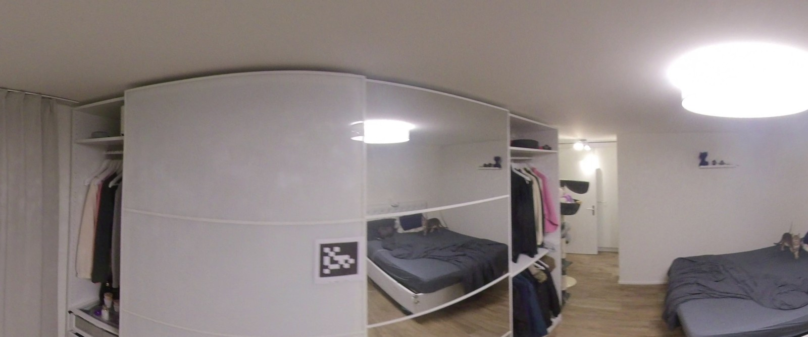
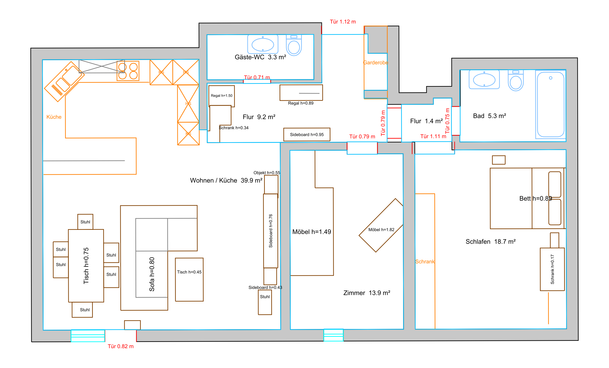

# Example: 360 degree indoor

[Back to the README](../../README.md#examples)

This example follows one real indoor project, `test_home_v11_tag`, from input
to result. The input is a 360 degree video of an apartment, recorded with an
Insta360 camera and exported from Insta360 Studio as a stitched
equirectangular `.mp4`. The project uses the capture type **360 degree
camera / Insta360** with the **Indoor** class set and AprilTags for the
metric scale. The example shows every workflow step: alignment and tag scale,
dense cloud, "Improve & filter", semantic classification, the clean DXF plan,
and the project overview with the computing times.

All viewer images use the same camera, the same display settings and the same
crop; the ceiling is hidden with the viewer's height filter (upper limit
2.2 m) so the rooms are visible from above.

## 1. Input

Crop of one equirectangular frame from the Insta360 video. 356 panorama frames
were extracted and split into 2,136 rig images. The AprilTag target TAG6 is
visible on the wardrobe.

## 2. Sparse cloud and camera alignment

COLMAP aligns the cameras (panorama rig in 17 min). The sparse cloud has
29,711 tie points (29,192 shown in the viewer). The eight AprilTags TAG0 to
TAG7 are detected and triangulated. Their known size of 150 mm gave a scale
factor of 1.236 (121.3 mm measured before scaling, all tags within 1.2 %).
See [AprilTag scale and georeferencing](../apriltag_scale.md).

## 3. Dense cloud before refinement

COLMAP dense stereo yields about 4.09 million points (2 h 18 min). Gaps on
white walls and floor, noise, and see-through areas are visible.

## 4. Dense cloud after "Improve & filter" (step 6)

The Depth-Anything prior and depth fill add about 13.9 million points
(18.0 million in total). Surface fusion snaps them onto one fused surface,
merges duplicates and removes mirror phantoms, see-through and hidden points,
leaving 3.36 million points (step 6 took 1 h 25 min, 1 h 02 min of it reading
depth maps). See [Improve & filter (step 6)](../../README.md#improve--filter-step-6).

## 5. Semantic classification

SAM3 (SegEarth-OV3) labels 1,440 images. Multi-view voting and the superpoint
vote (27,214 superpoints) assign a LAS class per point; colours are LAS
classes. 83.5 % of the points get a class, and 90 object instances are
found. Classification took 1 h 14 min. See
[Semantic classification](../../README.md#semantic-classification) and
[Object instances](../instances.md).

## 6. Clean DXF plan

The clean plan (orthophoto variant) of the same apartment, shown in the same
orientation as the viewer images (entrance door at the top). Walls are drawn
as double lines with a grey fill: 70.9 m of wall, exterior walls 0.31 m thick
(measured), interior walls in three learned thickness classes of 0.09, 0.21
and 0.25 m. Seven rooms are bounded by the walls and carry name and area:
Wohnen / Küche 39.9 m² (one open-plan room), Schlafen 18.7 m², Zimmer
13.9 m², Flur 9.2 m², Bad 5.3 m², Gäste-WC 3.3 m² and Flur 1.4 m². The plan
also holds 7 doors with their widths (0.71 to 1.12 m), 2 windows, sanitary
and kitchen symbols (bathtub, 2 washbasins, 2 WCs, cooktop, corner sink), the
U-shaped kitchen (counter drawn by its front lines, peninsula with a raised
bar, sink on the diagonal corner unit, dashed upper cabinet), the tall
built-in units (fridges "KS" and tall cabinets "HS" with a cross) with the
wall behind them, the dining table with its six chairs each in its own
labelled box, and furniture outlines with their heights whose shape is chosen
against the measured footprint (the corner sofa as an L with backrest and
corner-module lines), all on Cyclone/CAD layers. Computing everything on the
DXF page took 4 min 10 s.
See [DXF export](../../README.md#dxf-export) and
[Orthophoto clean plan](../ortho_plan.md).

## 7. Project overview in the UI

The workflow panel tracks all steps and their computing times (5 h 23 min in
total for this project on one GPU). The local source path is blanked out in
the screenshot. It shows the default German interface; English can be selected
in the settings (see [User interface](../../README.md#user-interface)).

## Other capture types

- [360 degree outdoor](outdoor_360.md)
- [Drone photos](drone.md)
- [Phone and handheld photos](phone.md)
