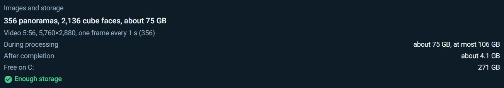
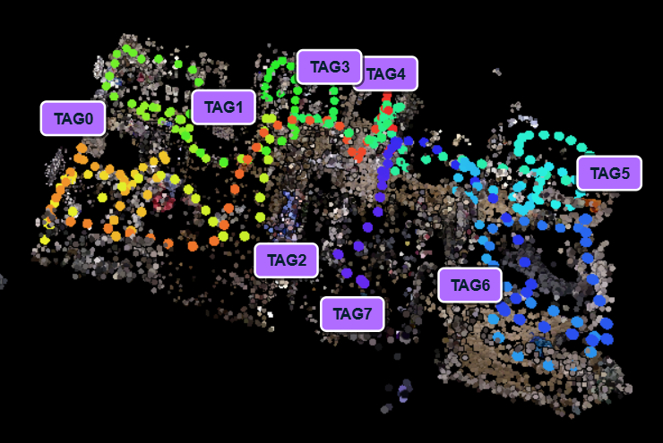
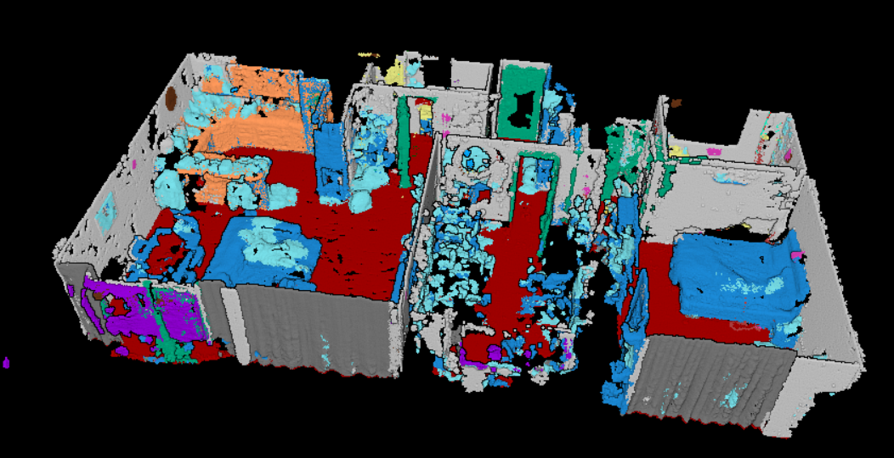
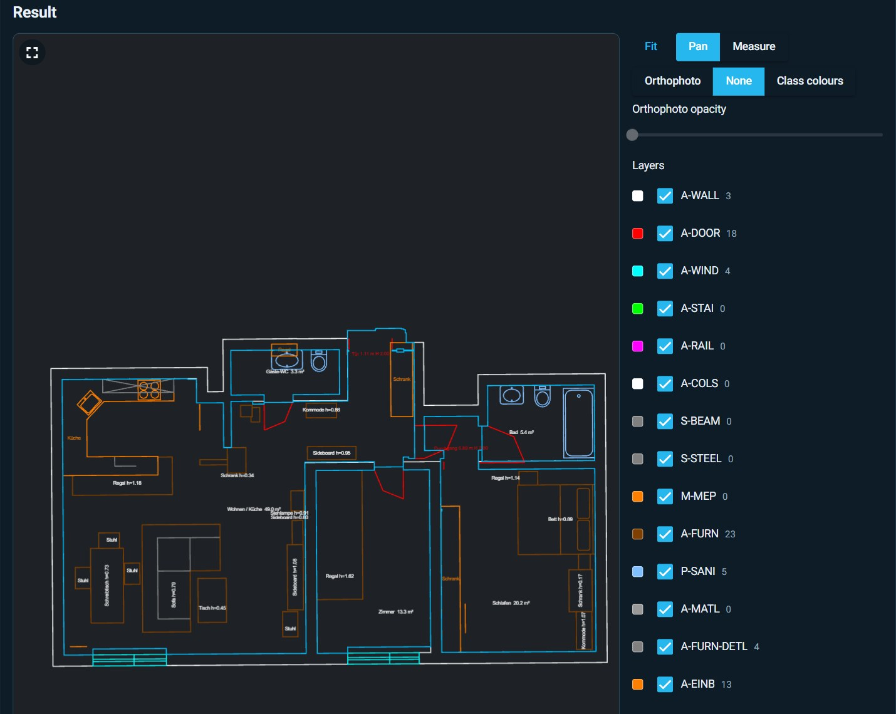
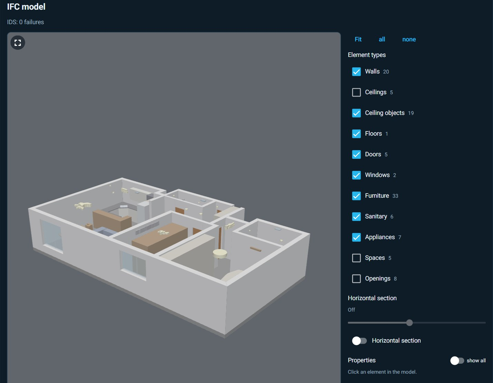
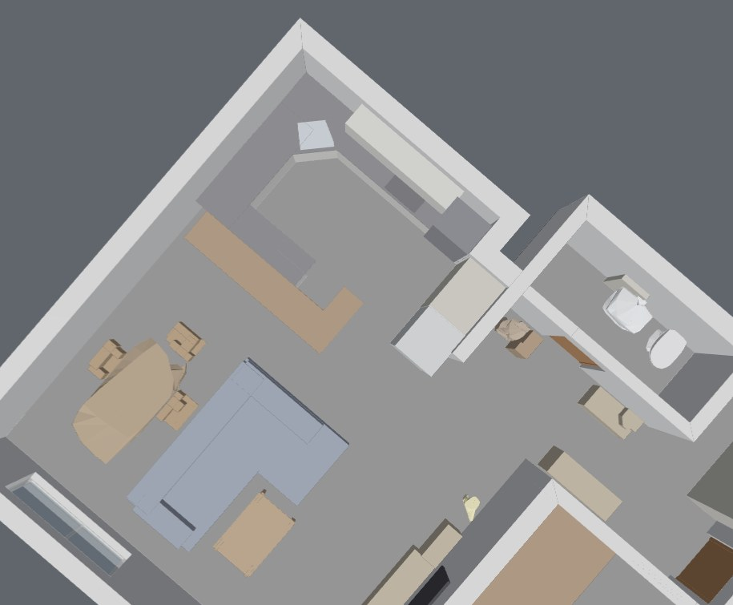
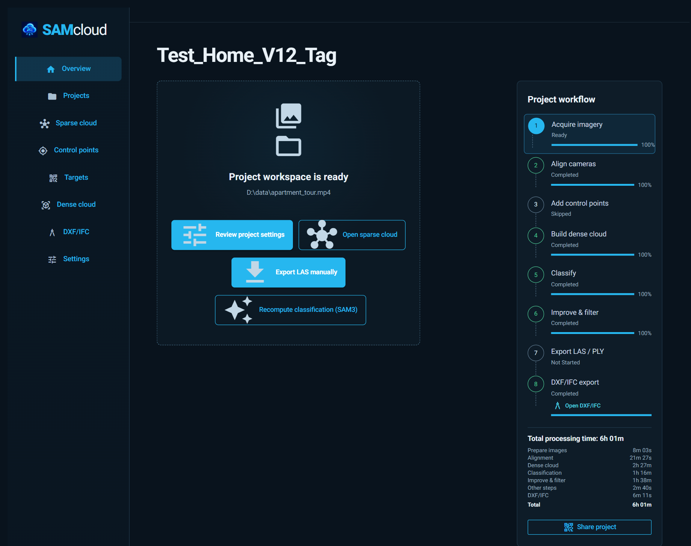

# Example: 360 degree indoor

[Back to the README](../../README.md#examples)

This example follows one real indoor project, `test_home_v12_tag`, from input
to result. The input is a 360 degree video of an apartment, recorded with an
Insta360 camera and exported from Insta360 Studio as a stitched
equirectangular `.mp4`. The project uses the capture type **360 degree
camera / Insta360** with the **Indoor** class set and AprilTags for the
metric scale. The example shows every workflow step: alignment and tag scale,
dense cloud, "Improve & filter", semantic classification, the DXF plan, the
IFC model, and the project overview with the computing times.

The DXF and IFC were recomputed on 2026-11-22 with the current code from this
run's existing cloud; the screen masks come from a later SAM3 pass over the
same images.

The screenshots show the English interface (**Settings** switches between
German and English). The exporter writes the room and object names inside the
plan in German.

The dense cloud images (sections 3 to 5) look at the flat from the same side,
with the ceiling hidden by the viewer's height filter (upper limit 2.2 m).
Sections 4 and 5 have the same camera and crop; section 3 is framed slightly
wider.

## 1. Input

Crop of one equirectangular frame from the Insta360 video. 356 panorama frames
were extracted and split into 2,136 rig images. The AprilTag target TAG6 is
visible on the wardrobe.

The create-project form checks the input before processing starts. For this
video at one frame per second it counts 356 panoramas and 2,136 cube faces and
estimates about 75 GB during processing (at most 106 GB) and about 4.1 GB
afterwards. "Free" is measured on the drive that holds the projects. The
estimate was calibrated on this recording, so other videos can deviate more.

## 2. Sparse cloud and camera alignment

COLMAP aligns the cameras as a panorama rig (21 min 27 s). The sparse cloud
has 29,874 tie points (29,340 shown in the viewer). The eight AprilTags TAG0
to TAG7 are detected and triangulated. Their known size of 150 mm gave a scale
factor of 1.238 (121.2 mm measured before scaling, all tags within 1.1 %, the
largest deviation is 1.04 %). See
[AprilTag scale and georeferencing](../apriltag_scale.md).

## 3. Dense cloud before refinement

COLMAP dense stereo and fusion yield 3,995,291 points (2 h 27 min). The image
shows this cloud directly after classification, before step 6. Gaps on white
walls and floor, noise, and see-through areas are visible.

## 4. Dense cloud after "Improve & filter" (step 6)

The Depth-Anything prior and depth fill add 13,964,905 points. Surface fusion
snaps the points onto one fused surface, merges duplicates and removes mirror
phantoms, see-through and hidden points, leaving 3,424,673 points. Step 6 took
1 h 38 min. See [Improve & filter (step 6)](../../README.md#improve--filter-step-6).

## 5. Semantic classification

SAM3 (SegEarth-OV3) labels 1,436 images. Multi-view voting and, in step 6, the
superpoint vote (27,807 superpoints) assign a LAS class per point; colours are
LAS classes. 93.6 % of the final points carry a class, and 98 object instances
are found. Classification took 1 h 16 min. See
[Semantic classification](../../README.md#semantic-classification) and
[Object instances](../instances.md).

## 6. Clean DXF plan

The DXF and IFC export is created automatically after processing (the project
setting **Create DXF/IFC automatically after processing**, default on). The
**DXF/IFC** page shows the result and lets you recompute it with **Compute
everything**.

The clean plan (orthophoto variant) is in true metres from the AprilTag scale
and has the entrance door at the top. Its five rooms go from door to door and
carry name and area:

| Room | Area |
|---|---|
| Gäste-WC | 3.32 m² |
| Bad | 5.43 m² |
| Schlafen | 20.22 m² |
| Zimmer | 13.34 m² |
| Wohnen / Küche | 49.03 m² |
| Total | 91.35 m² |

Kitchen, living room and entrance hall are one room because no door separates
them, and the small corridor joins the bedroom through the passage. The plan
has these openings:

| Opening | Count | Width |
|---|---|---|
| Interior doors | 4 | 0.74 m, 0.94 m, 0.84 m, 0.74 m |
| Entrance door | 1 | 1.11 m |
| Passage (no door) | 1 | 0.89 m |
| Windows, one mullion each | 2 | 1.88 m, 1.83 m |

The four interior doors are drawn with their open leaf on the measured hinge
and swing side. Walls are double lines: a wall with two scanned sides stands
on both of them where they can be paired, and the lintel above an opening has
the same faces as its wall. The plan also holds the sanitary and kitchen
symbols, the built-in units and the furniture outlines with their heights.

The exported DXF additionally holds the dashed layer `A-CLNG-OBJ` for objects
on the ceiling and the furniture outlines of the 3D reconstruction; the
preview on the page does not show these two. A 3D DXF
(`test_home_v12_tag_1_3d.dxf`) is written next to the 2D file. See
[DXF export](../../README.md#dxf-export) and
[Orthophoto clean plan](../ortho_plan.md).

## 7. IFC model

**Compute everything** runs orthophoto, segmentation, clean plan, **Refine
openings**, clean plan again, DXF export and IFC export (with the 3D DXF).
**Refine openings** measures windows and doors on their wall planes from the
SAM3 masks of the cube-face photos and from the point cloud: width, sill
height (BRH), head height (STH), mullions and open leaves. DXF and IFC are
written from the same building model (`plan_model.json`), so walls, rooms,
doors and windows match.

| IFC content | Result |
|---|---|
| Walls | 20 |
| Spaces | 5 |
| Doors / windows / passages | 5 / 2 / 1 |
| Furniture items, screens included | 46 |
| Furniture shapes: parts / mesh / footprint body | 27 / 12 / 7 |
| Screens | 4 (TV and 3 monitors) |
| Ceiling objects | 19 (9 spots, 5 lamps, 3 grilles, 2 of unknown type) |
| Columns / beams / stairs | 0 / 0 / 0 |
| IDS failures | 0 |
| Steps at openings (over 5 mm) | 0 |
| QA result | IFC4 OK |
| DXF/IFC computing time | 6 min 11 s |

The viewer splits the 46 furniture items into *Furniture* (33), *Sanitary* (6)
and *Appliances* (7, screens and floor lamp included). Element types can be
shown or hidden; ceilings, spaces and openings are hidden by default so the
view looks into the apartment.

A click on an element highlights it and opens its properties. The picked
window is 1.88 m wide and 1.66 m high, with sill height (BRH) 0.45 m, head
height (STH) 2.11 m and 1 mullion.

The diagonal corner unit follows its scanned front. It is 0.64 m long and
stands at 46.5° to the wall run that carries the hob (43.5° to the other run).
The sink (0.50 x 0.40 m) is parallel to the diagonal and lies in the worktop,
and the base steps back under the worktop where the scan shows it.

Walls, doors and windows are hidden in this image. Furniture is built from its
own points as parts (table top and legs, seat and back, boxes), as a compact
mesh, or as the footprint body where the points are too few. Screens are thin
panels measured in the points or, from the mask outlines, in the photos. A
shelf on the wall keeps its measured bottom. Ceiling objects have their own
element type in the viewer and stay visible while the ceilings are hidden.

Limits of this result:

- Validation on real data rests on one flat and one recording; the other tests
  are synthetic ([bench](../../README.md#synthetic-indoor-bench)).
- Furniture and objects need evidence in the points or masks. Small dark
  monitors and small ceiling fixtures can be missing or inaccurate, and
  irregular shapes stay rough.
- The entrance door has no wall-plane measurement: its width is the gap in the
  plan. Its head and the head of the passage are default values (about 2 m).
- Outer wall faces were not scanned. Where the second face is unknown, the
  wall thickness is assumed (0.285 m for the outer walls here).
- The combined IFC for several storeys is tested on synthetic data only; this
  flat has one storey.

See [IFC export](../ifc_export.md).

## 8. Project overview in the UI

The workflow panel tracks all steps and their computing times on one GPU:

| Step | Time |
|---|---|
| Prepare images | 8 min 03 s |
| Alignment | 21 min 27 s |
| Dense cloud | 2 h 27 min |
| Classification | 1 h 16 min |
| Improve & filter | 1 h 38 min |
| Other steps | 2 min 40 s |
| DXF/IFC | 6 min 11 s |
| Total | 6 h 01 min |

In the screenshot the source path is a placeholder and the storage line is
hidden. See [User interface](../../README.md#user-interface).

## Other capture types

- [360 degree outdoor](outdoor_360.md)
- [Drone photos](drone.md)
- [Phone and handheld photos](phone.md)
