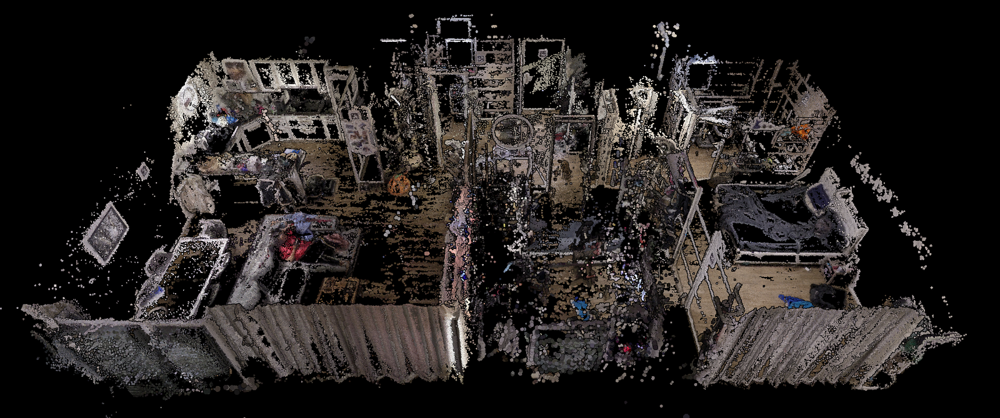
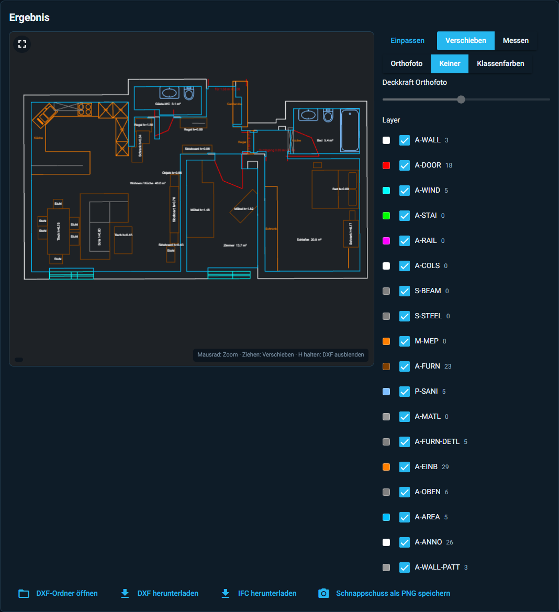
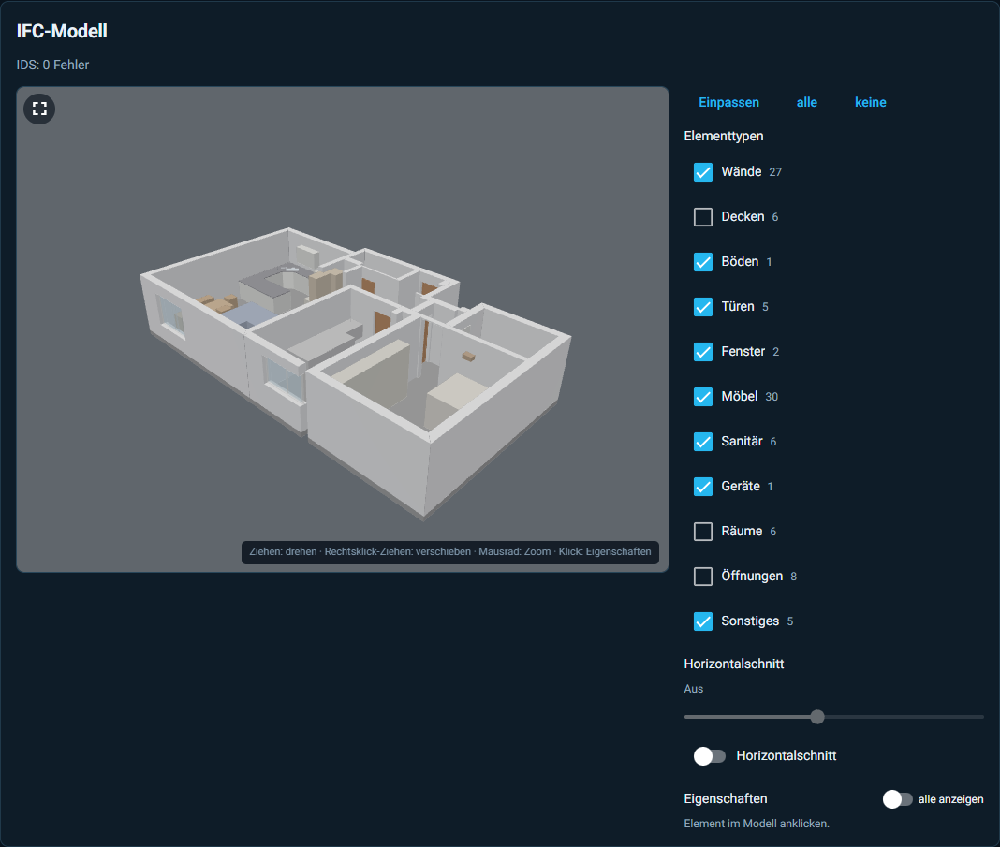
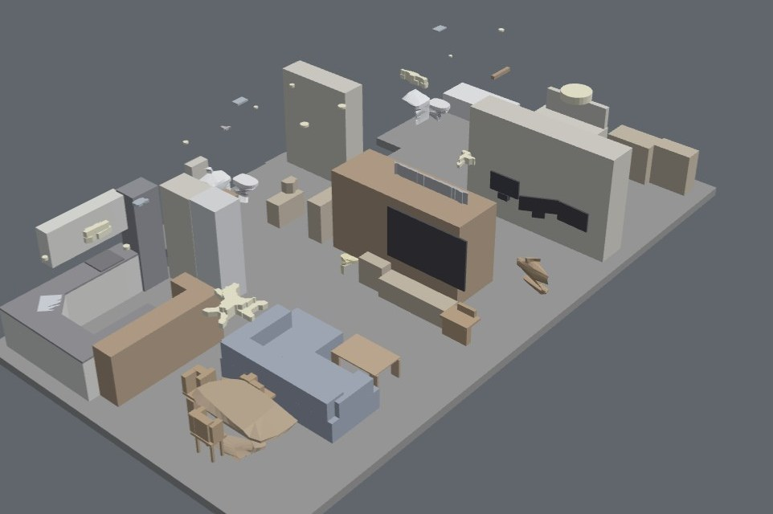

# Example: 360 degree indoor

[Back to the README](../../README.md#examples)

This example follows one real indoor project, `test_home_v11_tag`, from input
to result. The input is a 360 degree video of an apartment, recorded with an
Insta360 camera and exported from Insta360 Studio as a stitched
equirectangular `.mp4`. The project uses the capture type **360 degree
camera / Insta360** with the **Indoor** class set and AprilTags for the
metric scale. The example shows every workflow step: alignment and tag scale,
dense cloud, "Improve & filter", semantic classification, the clean DXF plan,
the IFC model, and the project overview with the computing times.

Sections 1 to 8 follow that run. The section
[Current DXF and IFC](#current-dxf-and-ifc-test_home_v12_tag) adds the export
of the current code for `test_home_v12_tag`. That project is a later processing
run of the same recording with the same 356 frames, not another scan.

All viewer images use the same camera, the same display settings and the same
crop; the ceiling is hidden with the viewer's height filter (upper limit
2.2 m) so the rooms are visible from above.

## 1. Input

Crop of one equirectangular frame from the Insta360 video. 356 panorama frames
were extracted and split into 2,136 rig images. The AprilTag target TAG6 is
visible on the wardrobe.

The create-project form checks the input before processing starts. For this
video at one frame per second it counts 356 panoramas and 2,136 cube faces and
estimates about 75 GB during processing (at most 106 GB) and about 4.1 GB
afterwards without the processing cache, and compares this with the free space
on the projects drive. The estimate was calibrated on this recording, so other
videos can deviate more.

## 2. Sparse cloud and camera alignment

COLMAP aligns the cameras (panorama rig in 17 min). The sparse cloud has
29,711 tie points (29,192 shown in the viewer). The eight AprilTags TAG0 to
TAG7 are detected and triangulated. Their known size of 150 mm gave a scale
factor of 1.236 (121.3 mm measured before scaling, all tags within 1.2 %).
See [AprilTag scale and georeferencing](../apriltag_scale.md).

## 3. Dense cloud before refinement

COLMAP dense stereo yields about 4.09 million points (2 h 18 min). Gaps on
white walls and floor, noise, and see-through areas are visible.

## 4. Dense cloud after "Improve & filter" (step 6)

The Depth-Anything prior and depth fill add about 13.9 million points
(18.0 million in total). Surface fusion snaps them onto one fused surface,
merges duplicates and removes mirror phantoms, see-through and hidden points,
leaving 3.36 million points (step 6 took 1 h 25 min, 1 h 02 min of it reading
depth maps). See [Improve & filter (step 6)](../../README.md#improve--filter-step-6).

## 5. Semantic classification

SAM3 (SegEarth-OV3) labels 1,440 images. Multi-view voting and the superpoint
vote (27,214 superpoints) assign a LAS class per point; colours are LAS
classes. 83.5 % of the points get a class, and 90 object instances are
found. Classification took 1 h 14 min. See
[Semantic classification](../../README.md#semantic-classification) and
[Object instances](../instances.md).

## 6. Clean DXF plan

The DXF and IFC export is created automatically after processing (the project
setting **Create DXF/IFC automatically after processing**, default on); the
DXF/IFC page shows the result and lets you recompute it.

Sections 6 and 7 show an earlier export of v11 (images of 2026-11-19) with the
numbers of that export. It still estimated the scale from the storey height
although the cloud was already metric, so its lengths are about 1.1 % and its
areas about 2.3 % too large. It also predates 3D furniture, ceiling objects
and the wall corrections of the
[current export](#current-dxf-and-ifc-test_home_v12_tag).

The clean plan (orthophoto variant) of the same apartment on the DXF/IFC page,
shown in the same orientation as the viewer images (entrance door at the top).
Walls are drawn as double lines with a grey fill. Five rooms go from door to
door and carry name and area: Gäste-WC 3.1 m², Bad 5.4 m², Zimmer 13.7 m²,
Schlafen 20.5 m² and Wohnen / Küche 48.6 m². Kitchen and living room are one
space, and the entrance hall is part of it because there is no door between
them. The small corridor joins the bedroom through the passage. The plan also
holds 5 doors with their widths (0.80 to 1.60 m), one passage (0.90 m, an
opening up to the ceiling without door leaf, drawn as jamb lines only) and 2
windows (1.85 m with two mullions, and 1.77 m with one mullion). Doors with a
measured open leaf (three here) are drawn with
their swing symbol on the measured hinge and swing side, sanitary and kitchen symbols,
the kitchen (counter drawn by its front lines, dashed upper cabinet), the tall
built-in units with the wall behind them, the dining table with its chairs
each in its own labelled box, and furniture outlines with their heights whose
shape is chosen against the measured footprint, all on Cyclone/CAD layers.
Door and window widths, sill and head heights come from the opening
refinement described in the next section.
See [DXF export](../../README.md#dxf-export) and
[Orthophoto clean plan](../ortho_plan.md).

## 7. IFC model

The same **Compute everything** button also writes the IFC. On indoor
projects the page is called **DXF/IFC**, and the run is: orthophoto, segment,
clean plan, **Refine openings**, clean plan again, DXF export, IFC export
(which now also writes a 3D DXF).
**Refine openings** measures every window and door on its wall plane from the
SAM3 masks of the cube-face photos (projected with the COLMAP poses, with
occlusion test) and from the point cloud: width, sill height (BRH), head
height (STH) and mullions; areas nobody saw stay unknown. It also tells a door
(door-class casing or lintel) from a passage (opening up to the ceiling, no
door) and from a candidate that is no opening at all, measures the head and the
headroom of every door and the hinge and swing of an open leaf, and finds
entrance doors in wall lines without opening. The DXF and the IFC
are both written from the same building model (`plan_model.json`), so walls,
rooms, doors and windows match. The DXF plan above and the IFC below come from this one model.

In this export the IFC viewer below the DXF preview shows 27 walls with
their openings, 5 doors, 1 passage (an opening without door), 2 windows, 5
rooms (6 room volumes, because a wall splits the bedroom into two pieces),
floor slab, 6 ceilings and 42 furniture items. The viewer split the furniture by IFC class into the
element types *Möbel* (30, `IfcFurniture`), *Sanitär* (6,
`IfcSanitaryTerminal`), *Geräte* (1, `IfcElectricAppliance`) and *Sonstiges*
(5, `IfcBuildingElementProxy`), which add up to the 42 items. Element types
can be shown or hidden; ceilings, rooms and openings are hidden by default so
the view looks into the apartment. The export is checked
against an IDS file (0 failures) and `qa.json` confirms that the openings of
the DXF and the IFC are identical.

A click on an element highlights it and opens its properties. The picked
window is 1.85 m wide and 1.40 m high, with sill height (BRH) 0.65 m, head
height (STH) 2.05 m and 2 mullions. See [IFC export](../ifc_export.md).

## 8. Project overview in the UI

The workflow panel tracks all steps and their computing times (5 h 28 min in
total for this project on one GPU: 5 h 23 min for the pipeline plus 4 min 32 s for the DXF/IFC export). The local source path is blanked out in
the screenshot. It shows the default German interface; English can be selected
in the settings (see [User interface](../../README.md#user-interface)).

## Current DXF and IFC (test_home_v12_tag)

`test_home_v12_tag` is a later processing run of the same recording of the
same flat: the 356 extracted frames are identical to those of v11. It is not a
second scan and no independent validation. Its AprilTag factor is 1.238, and
the plan takes this metric scale as it is (`scale_source: apriltag_scale`,
1.0 units per metre).

The DXF and IFC were recomputed on 2026-11-22 from the existing classified
cloud of this project, which has an older classification. The outlines of the
screen masks (`screen_masks.json.gz`) were added by a later SAM3 pass over the
same images; a new project writes this file itself during classification.

The clean plan has 5 rooms, 5 doors, 1
passage and 2 windows:

| Room | Area |
|---|---|
| Gäste-WC | 3.32 m² |
| Bad | 5.43 m² |
| Schlafen | 20.22 m² |
| Zimmer | 13.34 m² |
| Wohnen / Küche | 49.03 m² |
| Total | 91.35 m² |

A wall with two scanned sides stands on both of them where they can be paired,
and the lintel above an opening has the same faces as its wall. The exported
DXF additionally holds the dashed layer `A-CLNG-OBJ` for objects on the
ceiling and the furniture outlines of the 3D reconstruction; the preview on
the page does not show these two. A 3D DXF (`test_home_v12_tag_1_3d.dxf`) is
written next to the 2D file.

| IFC content | Result |
|---|---|
| Walls | 20 |
| Spaces | 5 |
| Furniture items, screens included | 46 |
| Furniture shapes: parts / mesh / footprint body | 27 / 12 / 7 |
| Screens | 4 (TV and 3 monitors) |
| Ceiling objects | 19 |
| Columns / beams / stairs | 0 / 0 / 0 |
| IDS failures | 0 |
| Steps at openings (over 5 mm) | 0 |
| QA result | IFC4 OK |
| DXF/IFC computing time | 6 min 22 s |

Furniture is built from its own points as parts (table top and legs, seat and
back, boxes), as a compact mesh, or as the footprint body where the points are
too few. Wall heights and ceiling heights come from the points where measured.

The diagonal corner unit follows its scanned front. It is 0.64 m long
and stands at 46.5° to the wall run that carries the hob (43.5° to the
other run). The sink (0.50 x 0.40 m) is parallel to the diagonal and lies
in the worktop, and the base steps back under the worktop where
the scan shows it.

Screens are thin panels with position, size and direction measured in the
points or, from the saved mask outlines, in the photos. A shelf on
the wall keeps its measured bottom and is not extended to the floor. Ceiling
objects have their own viewer category and stay visible while the ceilings are
hidden; they are written as light fixture, sensor, sprinkler, air terminal,
projector or, when the type is unknown, as proxy.

Limits of this result:

- Validation on real data so far rests on one flat and one recording. The
  other tests are synthetic ([bench](../../README.md#synthetic-indoor-bench)).
  Even between processing runs of this recording, room areas differed by up to
  about 6 % for the small rooms.
- Furniture, objects and structure need evidence in the points. Small dark
  monitors can be missing or too small, and so can small fixtures on the
  ceiling. Without photos or GPU the openings are measured from points only.
- Outer wall faces that were not scanned are not measured; these walls
  normally get the default thickness of 0.30 m.
- The combined IFC for several storeys is tested on synthetic data only; this
  flat has one storey.

See [IFC export](../ifc_export.md) and [Orthophoto clean plan](../ortho_plan.md).

## Other capture types

- [360 degree outdoor](outdoor_360.md)
- [Drone photos](drone.md)
- [Phone and handheld photos](phone.md)
