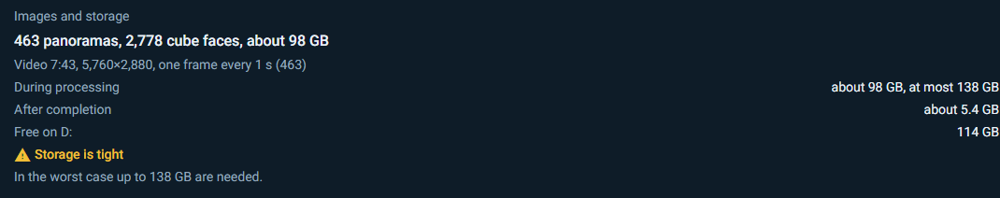
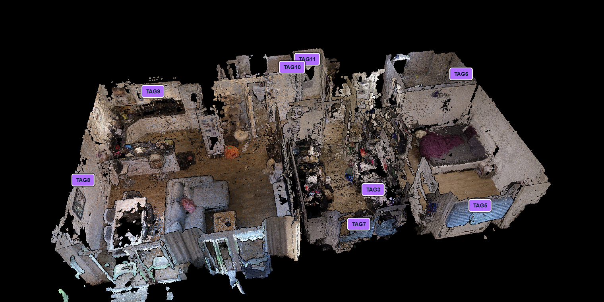
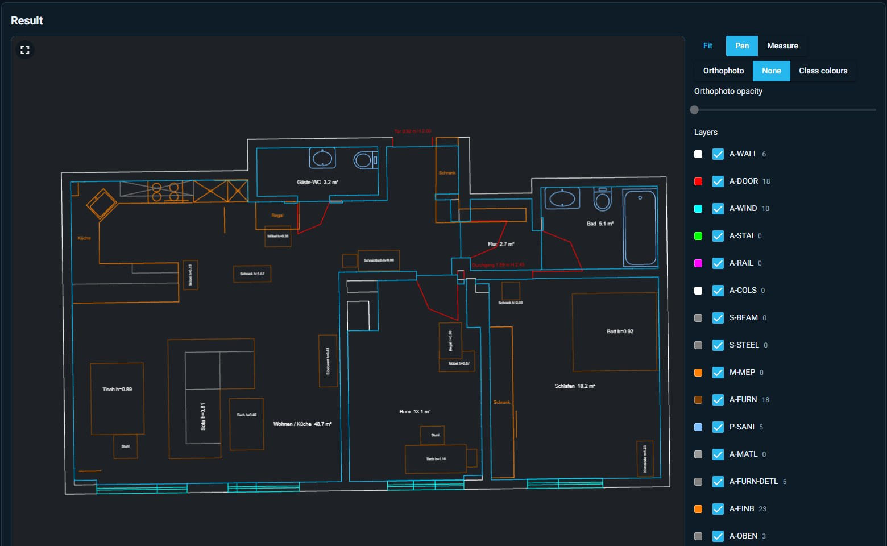
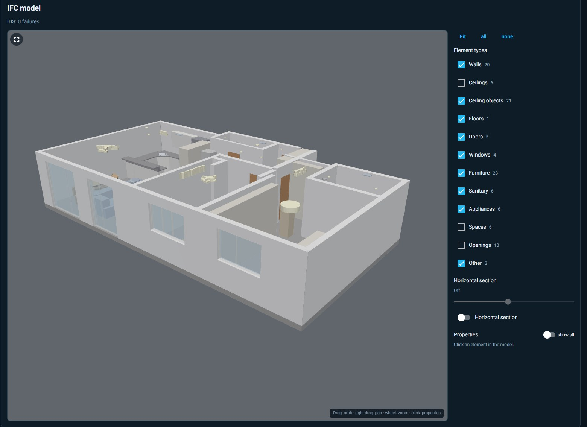
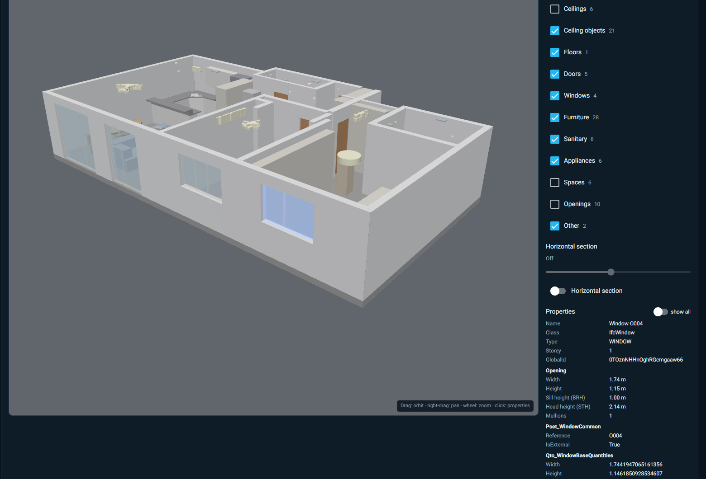
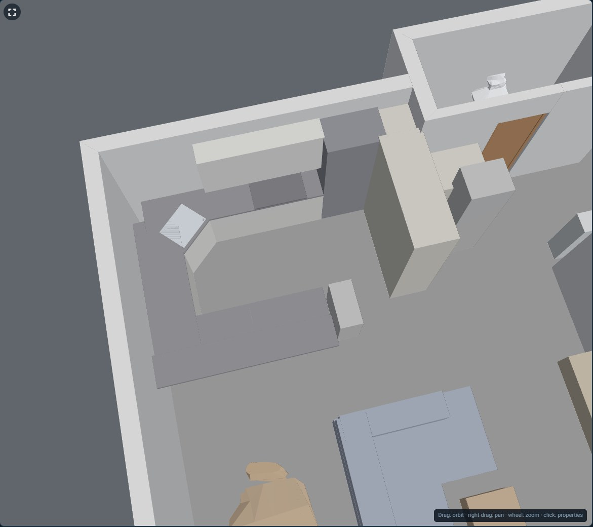
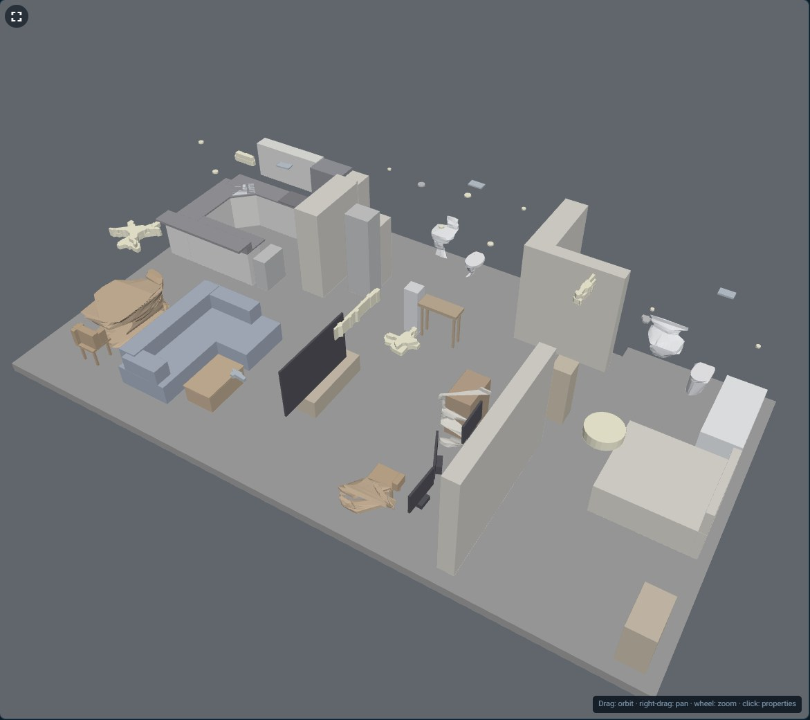

# Example: 360 degree indoor

[Back to the README](../../README.md#examples)

**Open the result in the browser:**
[point cloud, DXF plan and IFC model of this example](https://pub-c77fc3c3582246af9ffef1b9e877a798.r2.dev/share/indoor-360-example/index.html)
(a project share, see [Sharing by QR code](../../README.md#sharing-by-qr-code)).

This example follows one real indoor project, `test_home_v13_tag`, from input
to result. The input is a 360 degree video of an apartment, recorded with an
Insta360 camera and exported from Insta360 Studio as a stitched
equirectangular `.mp4`. The project uses the capture type **360 degree
camera / Insta360** with the **Indoor** class set and AprilTags for the
metric scale. The example shows every workflow step: alignment and tag scale,
dense cloud, "Improve & filter", semantic classification, the DXF plan, the
IFC model, and the project overview with the computing times.

The DXF and IFC were recomputed on 2026-11-23 with the current code from this
run's own cloud. The recording is the first one that was not used to develop
the indoor rules, so the result shows what the code does on new data,
including the points that are still wrong (see the limits in section 7).

The screenshots show the English interface (**Settings** switches between
German and English). The exporter writes the room and object names inside the
plan in German.

The dense cloud images (sections 3 to 5) look at the flat from the same side,
with the ceiling hidden by the viewer's height filter (upper limit 2.2 m).
Sections 4 and 5 have the same camera and crop; section 3 is framed slightly
wider.

## 1. Input

Crop of one equirectangular frame from the Insta360 video (the person who
holds the camera is cropped out). 463 panorama frames were extracted and split
into 2,778 rig images. The AprilTag TAG5 is visible on the bedroom window.

The create-project form checks the input before processing starts. For this
video (7:43) at one frame per second it counts 463 panoramas and 2,778 cube
faces and estimates about 98 GB during processing (at most 138 GB) and about
5.4 GB afterwards. "Free" is measured on the drive that holds the projects; the
check shows "Storage is tight" because the worst case needs more than is
free there. The finished project takes 3.0 GB (storage line in section 8). The
estimate was calibrated on an earlier recording, so other videos can deviate
more.

## 2. Sparse cloud and camera alignment

COLMAP aligns the cameras as a panorama rig (31 min 19 s). 425 of the 463
panoramas are registered. The 38 missing ones belong to a low camera pass
(bath, office, entrance, WC and the dining window); other passes cover the same
rooms. The sparse cloud has 41,972 tie points (40,214 shown in the viewer). The
eight AprilTags TAG3 and TAG5 to TAG11 are detected and triangulated. Their
known size of 150 mm gave a scale factor of 1.157 (128.2 to 130.5 mm measured
before scaling, all tags within 1.2 %, the largest deviation is 1.10 %). See
[AprilTag scale and georeferencing](../apriltag_scale.md).

## 3. Dense cloud before refinement

COLMAP dense stereo and fusion yield 5,206,811 points (2 h 51 min). The image
shows this cloud directly after classification, before step 6. Gaps on white
walls and floor, noise, and see-through areas are visible.

## 4. Dense cloud after "Improve & filter" (step 6)

The Depth-Anything prior and depth fill add 15,622,631 points. Surface fusion
snaps the points onto one fused surface, merges duplicates and removes mirror
phantoms, see-through and hidden points, leaving 3,638,080 points. Step 6 took
2 h 23 min. See [Improve & filter (step 6)](../../README.md#improve--filter-step-6).

## 5. Semantic classification

SAM3 (SegEarth-OV3) labels 1,822 images. Multi-view voting and, in step 6, the
superpoint vote (29,561 superpoints, 5.7 % of the points changed) assign a LAS
class per point; colours are LAS classes. The class coverage is 85.4 %, and 132
object instances are found. Classification took 1 h 51 min. See
[Semantic classification](../../README.md#semantic-classification) and
[Object instances](../instances.md).

## 6. Clean DXF plan

The DXF and IFC export is created automatically after processing (the project
setting **Create DXF/IFC automatically after processing**, default on). The
**DXF/IFC** page shows the result and lets you recompute it with **Compute
everything**.

The clean plan (orthophoto variant) is in true metres from the AprilTag scale
and has the entrance door at the top. Its six rooms go from door to door and
carry name and area:

| Room | Area |
|---|---|
| Gäste-WC | 3.21 m² |
| Bad | 5.11 m² |
| Flur | 2.74 m² |
| Wohnen / Küche | 48.71 m² |
| Schlafen | 18.19 m² |
| Büro | 13.12 m² |
| Total | 91.08 m² |

Kitchen, living room and the entrance area are one room because no door
separates them. The bedroom is joined to the hall by a passage. The plan has
these openings:

| Opening | Count | Width |
|---|---|---|
| Interior doors | 4 | 0.75 m, 0.85 m, 0.95 m, 0.95 m |
| Entrance door | 1 | 0.92 m (gap in the plan) |
| Passage (no door) | 1 | 1.59 m (see the limits in section 7) |
| Windows | 4 | 1.64 m, 1.74 m, 1.76 m, 2.09 m |

The four interior doors are drawn with their open leaf on the measured hinge
and swing side. Walls are double lines: a wall with two scanned sides stands
on both of them where they can be paired, and the lintel above an opening has
the same faces as its wall. Rooms end at the measured wall face; a wall ledge
that was measured ends the room, and a room never overlaps its neighbour.
The kitchen is a U shape with a diagonal corner unit at its measured angle, a
peninsula with a bar top, a tall row, one upper cabinet, a sink, a cooktop, an
oven and a fridge. The plan also holds the sanitary symbols, the built-in
units and the furniture outlines with their heights. Chairs are drawn only
where they were detected, and tables have their measured size.

The exported DXF additionally holds the dashed layer `A-CLNG-OBJ` for objects
on the ceiling and the furniture outlines of the 3D reconstruction; the
preview on the page does not show these two. A 3D DXF
(`test_home_v13_tag_1_3d.dxf`) is written next to the 2D file. See
[DXF export](../../README.md#dxf-export) and
[Orthophoto clean plan](../ortho_plan.md).

## 7. IFC model

**Compute everything** runs orthophoto, segmentation, clean plan, **Refine
openings**, clean plan again, DXF export and IFC export (with the 3D DXF).
**Refine openings** measures windows and doors on their wall planes from the
SAM3 masks of the cube-face photos and from the point cloud: width, sill
height (BRH), head height (STH), mullions and open leaves. A window head is
taken from the points when they clearly disagree with the photo. DXF and IFC
are written from the same building model (`plan_model.json`), so walls,
rooms, doors and windows match.

| IFC content | Result |
|---|---|
| Walls | 20 (from 38 wall pieces) |
| Spaces | 6 |
| Doors / windows / passages | 5 / 4 / 1 |
| Furniture items, screens included | 42 |
| Furniture shapes: parts / mesh / footprint body | 22 / 12 / 8 |
| Screens | 4 (TV and 3 monitors) |
| Ceiling objects | 21 (9 spots, 4 lamps, 4 ventilation grilles, 2 pendant lights, 2 of unknown type) |
| Columns / beams / stairs | 0 / 0 / 0 |
| IDS failures | 0 |
| EXPRESS findings | 0 |
| Steps at openings (over 5 mm) | 0 |
| QA result | IFC4 OK, re-import OK |
| DXF/IFC computing time | 9 min 03 s |

The viewer splits the 42 furniture items into *Furniture* (28), *Sanitary* (6),
*Appliances* (6, screens included) and *Other* (2). Element types can be shown
or hidden; ceilings, spaces and openings are hidden by default so the view
looks into the apartment.

A click on an element highlights it and opens its properties. The picked
window is 1.74 m wide and 1.15 m high, with sill height (BRH) 1.00 m, head
height (STH) 2.14 m and 1 mullion.

The kitchen follows the scan: the diagonal corner unit has its measured front
and carries the sink, the peninsula ends in a bar top, and the tall row, the
oven tower and the upper cabinet stand where the points are. Ceiling objects
are hidden in this image.

Walls, doors and windows are hidden in this image. Furniture is built from its
own points as parts (table top and legs, seat and back, boxes), as a compact
mesh, or as the footprint body where the points are too few. Screens are thin
panels taken from the SAM3 masks and the points. A shelf on the wall keeps its
measured bottom, and built-in units have readable names (for example
*Hochschrank*, *Oberschrank*, *Einbauschrank*). Ceiling objects have their own
element type in the viewer and stay visible while the ceilings are hidden.

Measured against the cloud, the model is close where the scan has evidence:
wall faces with face evidence 0.0 to 1.5 cm, door heads within 5 cm, window
heads within 4 to 9 cm, kitchen faces 1 to 3.5 cm and the upper cabinet front
6 cm.

Limits of this result:

- The passage between the hall and the bedroom is modelled about 0.7 m too
  wide: that wall has almost no points in this recording.
- A few continuation walls stand 3 to 5.5 cm off the scanned face.
- The head of the large living-room window is about 5 to 9 cm too high; the
  evidence grid is 5 cm.
- The rules were developed on earlier recordings of the same flat. This
  recording is the first independent test, but it is still one flat; the other
  tests are synthetic ([bench](../../README.md#synthetic-indoor-bench)).
- Furniture and objects need evidence in the points or masks. Small dark
  monitors and small ceiling fixtures can be missing or inaccurate, and
  irregular shapes stay rough.
- The entrance door has no wall-plane measurement: its width is the gap in the
  plan, and its head is a default value (about 2 m).
- Outer wall faces were not scanned. Where the second face is unknown, the
  wall thickness is assumed (0.21 m for the outer walls here).
- The combined IFC for several storeys is tested on synthetic data only; this
  flat has one storey.

See [IFC export](../ifc_export.md).

## 8. Project overview in the UI

The workflow panel tracks all steps and their computing times on one GPU.
Step 3 shows the number of AprilTags found, and step 1 shows the extracted
frames while the video is processed:

| Step | Time |
|---|---|
| Prepare images | 10 min 12 s |
| Alignment | 31 min 19 s |
| Dense cloud | 2 h 51 min |
| Classification | 1 h 51 min |
| Improve & filter | 2 h 23 min |
| Other steps | 8 min 26 s |
| DXF/IFC | 9 min 03 s |
| Total | 8 h 05 min |

In the screenshot the source path is a placeholder. See
[User interface](../../README.md#user-interface).

## Other capture types

- [360 degree outdoor](outdoor_360.md)
- [Drone photos](drone.md)
- [Phone and handheld photos](phone.md)
