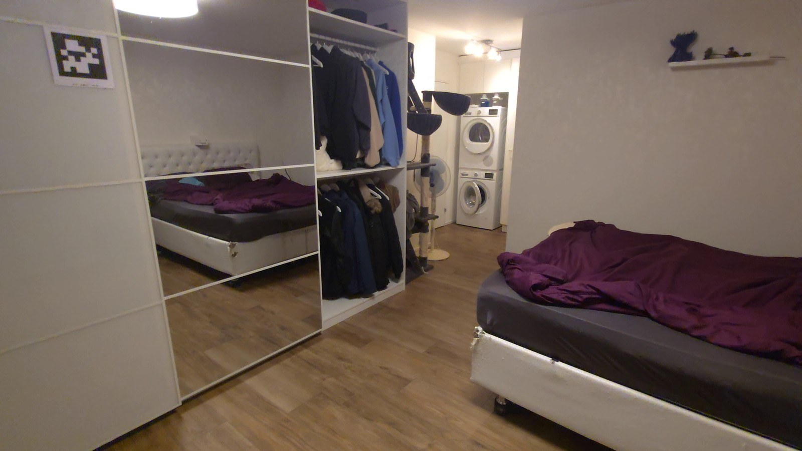
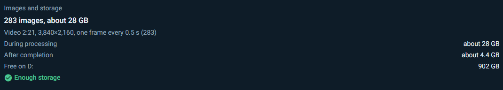
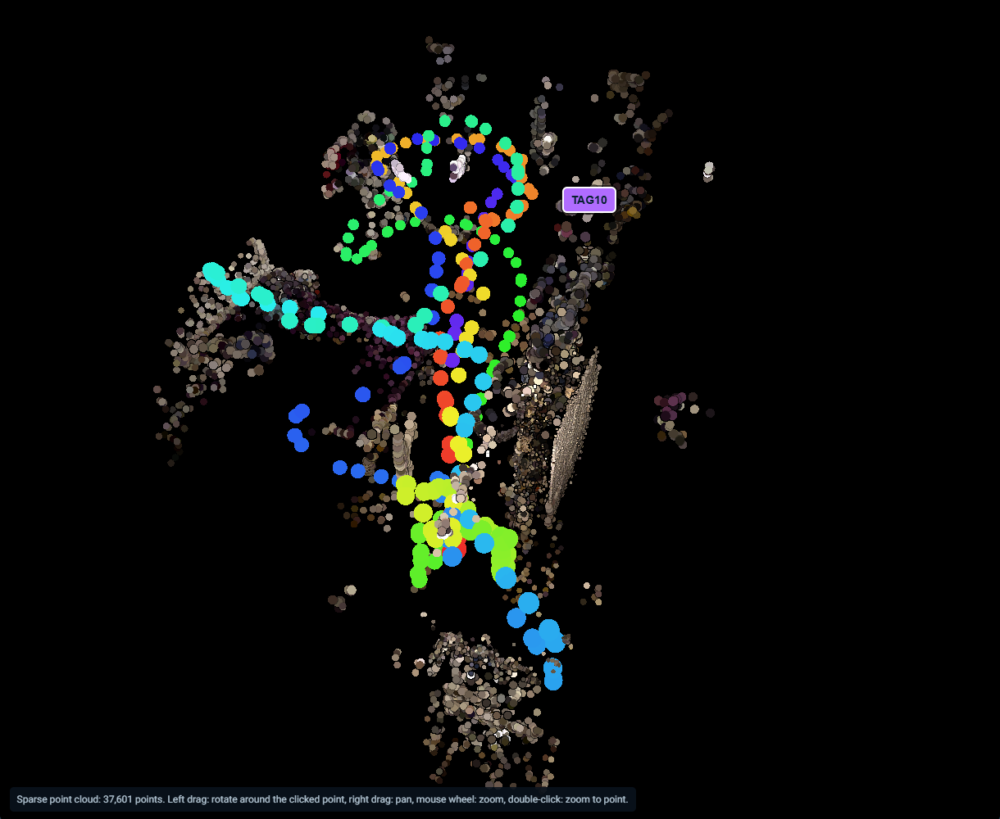
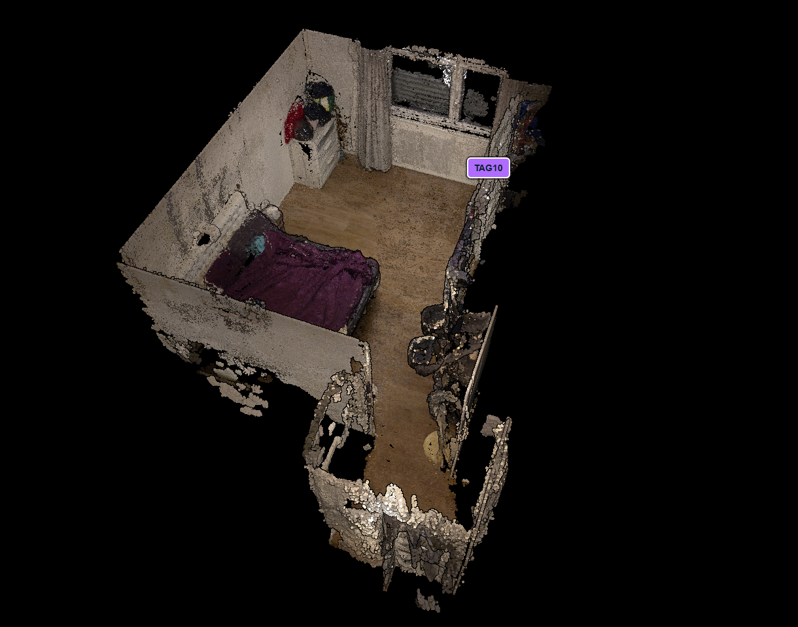
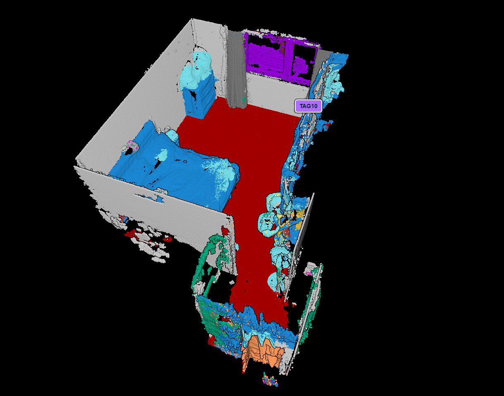
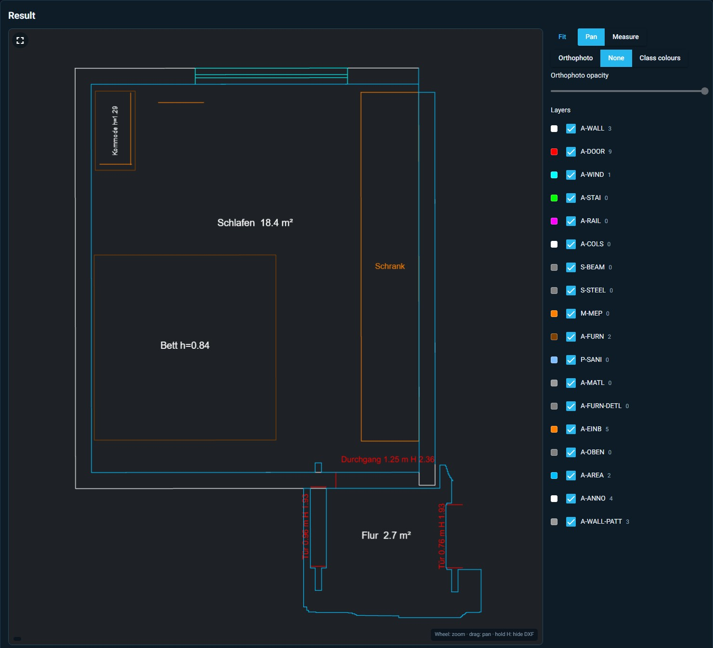
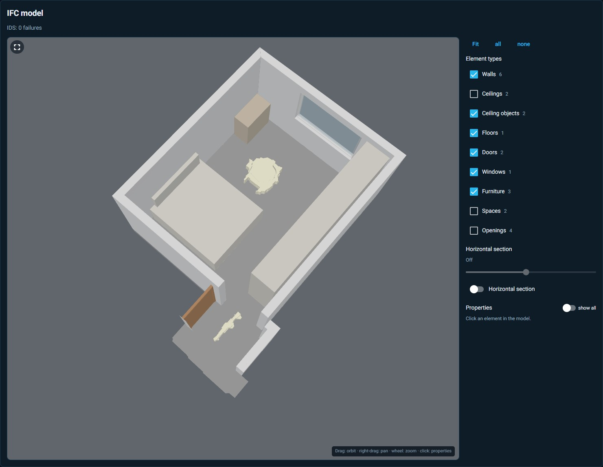
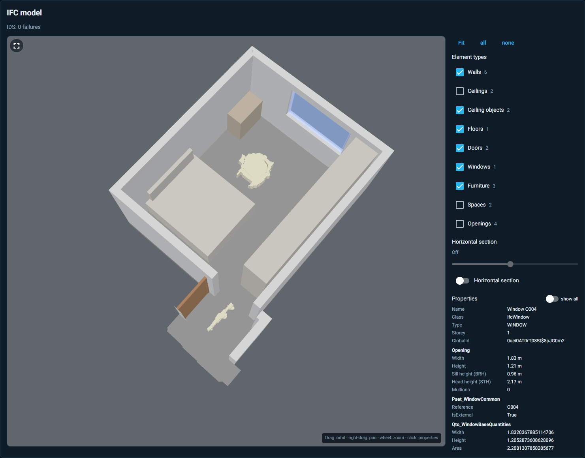
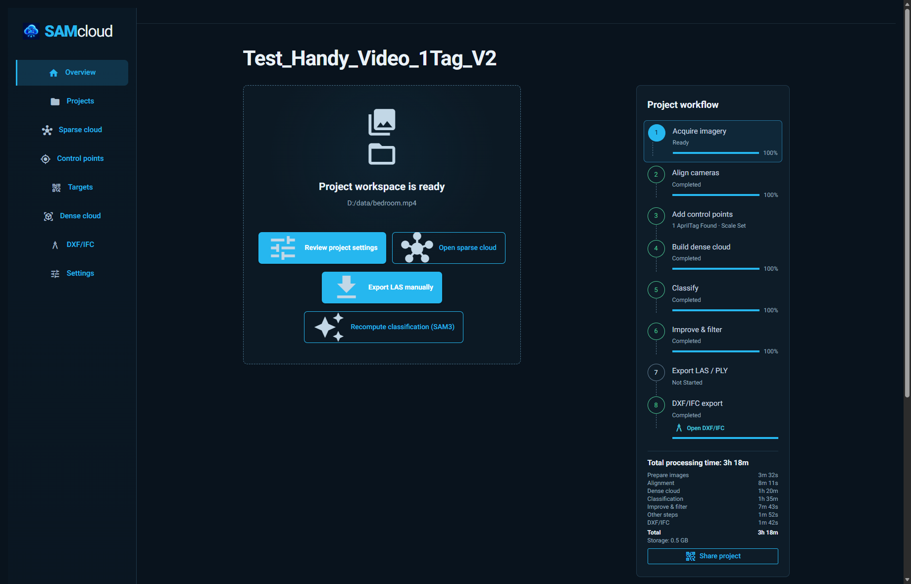

# Example: phone video and handheld photos

[Back to the README](../../README.md#examples)

**Open the result in the browser:**
[point cloud, DXF plan and IFC model of this example](https://pub-c77fc3c3582246af9ffef1b9e877a798.r2.dev/share/phone-video-example/index.html)
(a project share, see [Sharing by QR code](../../README.md#sharing-by-qr-code)).

This example follows one real indoor project, `test_handy_video_1tag_v2`, from
input to result. The input is a phone video (4K, 60 frames per second, 2:21)
of one bedroom. The project uses the capture type **Standard camera** with the
video as input, the **Indoor** class set and one AprilTag (TAG10) for the
metric scale. The example shows every workflow step: alignment, levelling and
tag scale, dense cloud, "Improve & filter", semantic classification, the DXF
plan, the IFC model, and the project overview with the computing times. It
ends with a comparison of the room with the same bedroom in the
[360 degree indoor example](indoor_360.md). The general capture guide for this
capture type (photos or video, levelling, scale, project settings, which
steps apply) is in section 10.

The DXF and IFC were recomputed on 2026-11-24 with the current code from this
run's own cloud. This recording is a single room that was filmed in one
walk-around, and the plan rules for it were written after its first export
(section 5), so it is not an independent test. The limits are in section 8.

The screenshots show the English interface (**Settings** switches between
German and English). The exporter writes the room and object names inside the
plan in German.

The dense cloud images (sections 3 and 4) look at the room from the same side,
with the ceiling hidden by the viewer's height filter (upper limit 2.2 m
above the floor) and the same camera and crop.

## 1. Input

One frame of the video, reduced in size. The AprilTag TAG10 is on the
wardrobe door at the top left; the mirror door next to it shows the bed. The
phone video is 3,840 x 2,160 px at 59.96 frames per second, 2:21 long and
1.09 GB. The project keeps the video where it is and extracts frames from it:
for each window of 0.5 s the sharpest frame is kept (sharpness is the variance
of the Laplacian of the frame at reduced size). This gives 283 frames (the
last one at 141.1 s) in `inputs/video_frames`, 269 MB, and took 3 min 32 s.

The create-project form checks the input before processing starts. For this
video at one frame every 0.5 s it counts 283 images and estimates about 28 GB
during processing and about 4.4 GB afterwards. The drive that holds the
projects had 902 GB free, so the check shows "Enough storage". The finished
project takes 0.5 GB after the storage cleanup (storage line in section 9). The
estimate was calibrated on a 360 degree recording, so for a phone video it is
conservative.

## 2. Sparse cloud, levelling and tag scale

COLMAP matches every frame pair (exhaustive matching) and builds the model
with the incremental mapper (8 min 11 s: feature extraction 14 s, matching
4 min 16 s, mapping 3 min 30 s, tie point filtering and bundle adjustment
12 s). 275 of the 283 frames are registered. The 8 missing frames lie between
107 s and 114 s of the video, close-ups of washing machines and white doors
with little texture. The sparse cloud has 40,599 tie points (37,601 shown in
the viewer) and the camera positions follow the walk through the room and out
into the hall.

The mapper made one model in this run. If it splits into several models, the
largest one is used automatically. In an earlier attempt on the same frames
the first model had only 4 images and the run stopped (the pipeline requires
at least 30 % of the images and 1,000 points).

**Scale.** The AprilTag TAG10 (150 mm) is detected in 35 frames. It measured
283.9 units in the unscaled model, so the model was scaled by 0.5283 and the
tag is 149.96 mm afterwards, with a reprojection error of 1.09 px. With one
tag there is no second tag to compare with, so the check reports "only 1
AprilTag found, no control possible" and the 0.0 % deviation is trivial. See
[AprilTag scale and georeferencing](../apriltag_scale.md).

**Level.** COLMAP returns the model in an arbitrary orientation (it was tilted
by 92.3 degrees). Indoor projects of the standard camera without control
points are levelled automatically from the camera "up" directions (spread 15.4
degrees RMS, 263 of 275 frames kept after outlier removal) and a floor plane
in the sparse points (320 of 863 candidate points). The plane corrects the up
direction by 2.3 degrees and the floor goes to z = 0, 1.60 m below the
cameras. A separate check on 12,000 sparse points finds a largest near-horizontal
plane 13.9 degrees off the levelled Z (1,828 inliers) and raises a warning.
The dense cloud measured at the DXF step is level to 0.07 degrees, so the
warning was not confirmed.

## 3. Dense cloud

COLMAP dense stereo (2,100 px, 3 iterations, geometric consistency) and fusion
yield 3,809,719 points (77 min 30 s stereo and 2 min 31 s fusion, 1 h 20 min
for the step). The image shows the final cloud after "Improve & filter"
(step 6), 835,483 points: the Depth-Anything depth fill adds 3,337,432
points confirmed by several views, then surface fusion snaps the points onto
one fused surface (6,865,111 points moved), merges duplicates and removes
mirror phantoms, see-through and hidden points. Step 6 took 7 min 43 s. The
wardrobe has mirror doors, so the mirror detection of step 6 is relevant here. See
[Improve & filter (step 6)](../../README.md#improve--filter-step-6). The
geometric refinement is skipped because the reconstruction is not
georeferenced (section 8).

## 4. Semantic classification

SAM3 (SegEarth-OV3) labels 275 images (1 h 35 min). Multi-view voting and, in
step 6, the superpoint vote (6,591 superpoints, 3.9 % of the points changed)
assign a LAS class per point; colours are LAS classes (floor red, windows
violet, walls light grey, furniture blue). The class
coverage is 70.05 %: 250,228 of the 835,483 points stay unknown. 26 object
instances carry an instance ID (195,450 points). See
[Semantic classification](../../README.md#semantic-classification) and
[Object instances](../instances.md).

## 5. Clean DXF plan

The DXF and IFC export is created automatically after processing (the project
setting **Create DXF/IFC automatically after processing**, default on). The
**DXF/IFC** page shows the result and lets you recompute it with **Compute
everything**.

The clean plan (orthophoto variant) is in metres from the AprilTag scale. The
plan frame is turned by about 24.5 degrees so the walls run along the axes;
there is no georeference, so the orientation is arbitrary (here the window is at
the top and the hall at the bottom). Its two rooms:

| Room | Area |
|---|---|
| Schlafen | 18.40 m² |
| Flur (fragment) | 2.66 m² |
| Total | 21.07 m² |

The bedroom is closed on all four sides by walls of 0.193 m. That thickness is
an assumption: a single room scanned from the inside has no measured wall
thickness, so every wall takes the prior of 0.20 m (scaled by the room height
estimate). The "Flur" is only the part of the hall that the video shows
through the passage and two doors. The plan has these openings:

| Opening | Count | Width |
|---|---|---|
| Doors (hall fragment) | 2 | 0.76 m, 0.96 m (heads are default values) |
| Passage (no door) | 1 | 1.25 m, head 2.36 m |
| Window | 1 | 1.83 m, sill 0.96 m, head 2.17 m |

The plan also holds the chest of drawers (*Kommode*), the bed (*Bett*, 2.19 x
1.87 m) and the built-in wardrobe along the wall (*Einbauschrank*, 4.07 x
0.65 m, 2.37 m high). The ceiling lamp and a pendant light are on the dashed
layer `A-CLNG-OBJ` of the exported DXF; the preview on the page does not show
that layer. A 3D DXF (`test_handy_video_1tag_v2_1_3d.dxf`, 17 meshes) is
written next to the 2D file, and the exported files pass the ezdxf audit. See
[DXF export](../../README.md#dxf-export) and
[Orthophoto clean plan](../ortho_plan.md).

**What the first export showed and what was changed.** The first export of
this recording was not usable: one room of 20.13 m² with a ragged outline
(fill 0.65, 120 vertices) that ran out through a gap in the south wall into the
hall, wall thicknesses of 0.289 m and 0.145 m, no wall behind the wardrobe
and the bed named *nightstand*. The following generic rules were added, none
of them specific to this flat:

- Walls without any measured thickness take a prior of 0.20 m (before: 0.30 m
  for exterior and 0.15 m for interior walls). Measured flats are not touched.
- A wall behind a tall built-in unit is followed along the front to the
  longest wall stub behind it, but never across measured free floor.
- A label is checked against the footprint size: a *nightstand* cannot be
  longer than 0.8 m, so the next label vote is used (here the bed).
- The bed outline is cut back to the points at mattress height where a low
  neighbour (bench, blanket) had been merged into it (2.23 x 2.19 m before,
  2.19 x 1.87 m now).
- An empty-array error in the niche step (it stopped the first automatic
  export after 85 s) is guarded; the export was rerun.

After these changes the bedroom is 18.40 m² (360: 18.19 m²) and the hall
fragment is separate. The 360 degree recordings give the same plan as before
(rooms, walls, openings, furniture and IFC checks unchanged).

## 6. IFC model

**Compute everything** runs orthophoto, segmentation, clean plan, **Refine
openings**, clean plan again, DXF export and IFC export (with the 3D DXF). This
recording has no photographs for the opening refinement, so it measures the
window and the passage from the point cloud only. DXF and IFC are written from
the same building model (`plan_model.json`), so walls, rooms, doors and
windows match.

| IFC content | Result |
|---|---|
| Walls | 6 (from 8 wall pieces) |
| Spaces | 2 |
| Doors / windows / passages | 2 / 1 / 1 |
| Furniture items | 3 (chest, bed, built-in wardrobe) |
| Furniture shapes: parts / mesh / footprint body | 3 / 0 / 0 |
| Screens | 0 |
| Ceiling objects | 2 (1 lamp, 1 pendant light) |
| Columns / beams / stairs | 0 / 0 / 0 |
| IDS failures | 0 |
| EXPRESS findings | 0 |
| Steps at openings (over 5 mm) | 1 (door O002, 114 mm) |
| QA result | IFC4 with findings (3 warnings), re-import OK |
| DXF/IFC computing time | 1 min 42 s |

The three QA warnings: door O002 was shifted 0.018 m along its wall to clear a
join cut, its right jamb has a step of 114 mm (tolerance 5 mm), and the passage
overlaps the end of the east wall by 251 mm. Wall overlaps are 0, and room areas
and openings agree between plan and IFC (18.40 m² and 2.63 m² in the IFC). The
viewer lists walls (6), ceilings (2), ceiling objects (2), floors (1), doors
(2), windows (1), furniture (3), spaces (2) and openings (4); ceilings, spaces
and openings are hidden by default so the view looks into the room.

A click on an element highlights it and opens its properties. The picked
window is 1.83 m wide and 1.21 m high, with sill height (BRH) 0.96 m, head
height (STH) 2.17 m and no mullion. Window and passage heads come from the
points. The two doors have no wall-plane measurement of their own: their
width is the gap in the plan, no leaf was detected, and their head is a
default value (1.93 m).

See [IFC export](../ifc_export.md).

## 7. The same bedroom in the 360 degree example

The 360 degree example (`test_home_v13_tag`, section 6 of the
[360 degree indoor example](indoor_360.md)) contains this bedroom as *Schlafen*
and gives a reference from a second, independent recording. Both models come
from the same code; neither was measured with a tape.

| | Phone video | 360 degree video |
|---|---|---|
| Room area | 18.40 m² | 18.19 m² |
| Room height (floor to ceiling) | 2.41 m | 2.49 m |
| Wall thickness | 0.193 m (assumed) | 0.21 m (measured, exterior) |
| Window (width, sill, head) | 1.83 m, 0.96 m, 2.17 m, no mullion | 1.74 m, 1.00 m, 2.14 m, 1 mullion |
| Passage to the hall | 1.25 m | 1.59 m |
| Bed (long side x short side) | 2.19 x 1.87 m, 1.19 m high | 1.99 x 1.79 m, 1.21 m high |
| Chest of drawers | 0.92 x 0.47 m, 0.95 m high | 0.88 x 0.51 m, 0.96 m high |
| Built-in wardrobe | 4.07 x 0.65 m, 2.37 m high | 3.49 x 0.33 m, 2.41 m high |
| Hall | fragment of 2.66 m² with 2 doors | whole flat, *Flur* of 2.74 m² |

The room agrees within 1.2 % in area; window width and height differ by 9 cm
and 6 cm, the chest by 4 cm. Where the two differ clearly:

- The plan of the phone video is turned by 180 degrees against the 360
  degree plan, because both are in their own local frame.
- The bed is 20 cm longer and 8 cm wider in the phone model. The points show
  a bed 2.2 m long and about 1.7 m wide, so the length is what the points
  show; which of the two is closer to the real bed is not measured.
- The built-in wardrobe is deeper (0.65 m against 0.33 m) and longer
  (4.07 m against 3.49 m) in the phone model. There the wall behind the unit
  was missing and was bridged with the rule from section 5.
- The 360 plan has a passage of 1.59 m that is known to be about 0.7 m too wide
  (that wall has almost no points in the 360 recording). The phone value of
  1.25 m is not confirmed by a measurement either and may be too wide too.
- The 360 model also has a small cabinet (0.41 x 0.41 m) that the phone model
  lacks, and the 360 room is 8 cm higher.

## 8. Limits of this result

- **One AprilTag.** It sets the scale but gives no check, so a scale error
  cannot be seen. The room is 8 cm lower than in the 360 model while its
  floor area is 1.2 % larger; with one tag and a barely filmed ceiling this
  cannot be separated into scale and measurement error.
- **The ceiling was barely filmed.** Only 23,848 of the 3.8 million raw points
  (0.6 %) are classified as ceiling, and the ceiling rooms that the plan could
  use cover only 4.9 + 1.0 + 1.8 m². The rooms are therefore built from the
  floor and the door lines.
- **Arbitrary plan orientation.** The reconstruction is in the `LOCAL` frame
  without georeference. Geometric refinement is not applied because it needs
  one.
- **The hall is only partly seen.** The "Flur" fragment has two doors whose
  heads are default values (confidence about 0.35), and its outline is ragged.
- **The passage is 1.25 m**, see section 7; the passage also overlaps the end
  of the east wall by 251 mm (QA warning).
- **Wall thickness is assumed** (0.193 m for all six walls, all kind
  *exterior*). Outer faces were not scanned.
- **Heights in the plan labels.** The labels of the bed (h = 0.84) and the
  chest (h = 1.29) differ from the IFC solids (1.19 m, 0.95 m); this difference
  is not resolved.
- **8 of 283 frames are not registered** (107 s to 114 s, close-ups of white,
  textureless surfaces).
- **Class coverage is 70.05 %** (360: 85.4 %). The raw cloud has 81,063 points
  labelled *column* in a room without columns.
- **One room, one recording.** The rules for this room were written after its
  first export. The combined IFC for several storeys is tested on synthetic
  data only.

## 9. Project overview in the UI

The workflow panel tracks all steps and their computing times on one GPU.
Step 3 shows the AprilTag found ("1 AprilTag Found - Scale Set"):

| Step | Time |
|---|---|
| Prepare images | 3 min 32 s |
| Alignment | 8 min 11 s |
| Dense cloud | 1 h 20 min |
| Classification | 1 h 35 min |
| Improve & filter | 7 min 43 s |
| Other steps | 1 min 52 s |
| DXF/IFC | 1 min 42 s |
| Total | 3 h 18 min |

The pipeline alone took 3 h 16 min 33 s. The storage line shows 0.5 GB: the
cleanup after the run freed 553 MB (dense stereo and image copies were deleted,
the database and the fused cloud were compressed). In the screenshot the video
path is a placeholder. See [User interface](../../README.md#user-interface).

## 10. Capture guide for the standard camera

**What this capture type is for.** Photos or a video from a phone, a compact
camera or a DSLR, indoors or outdoors, for rooms, objects or small sites where
no drone or 360 degree camera is used. SAMcloud treats them as the capture
type **Standard camera** (`camera`).

**Input: photos or a video.**

- **Photos:** `.jpg`, `.jpeg`, `.tif`, `.tiff` and `.png` in the image folder
  (subfolders included). Source images stay at their original location.
- **Video:** one video file or a folder of videos (`.mp4`, `.mov`, `.m4v`,
  `.avi`, `.mkv`). For each window of the frame interval (default 1 s, 0.5 s in
  this example) the sharpest frame is kept; frames of several videos are
  numbered continuously and written to `inputs/video_frames` with a manifest.
  The video itself stays where it is. Give either photos or a video, not both.
  The capture settings are locked once the frames exist.
- **Overlap.** Every image pair is matched (exhaustive matching). The run stops
  with "Check image overlap/quality" when COLMAP builds no reconstruction, and
  when the largest model registers fewer than 30 % of the images or fewer than
  1,000 points. If the mapper splits into several models, the largest one is
  used.
- **Filming tips from this recording.** Move slowly and keep the phone in one
  orientation. Avoid long close-ups of white, flat surfaces (that stretch was not
  registered). Film the ceiling edge and the upper walls if you want ceilings
  and heights, and film a neighbouring room through its door if it should be
  modelled.
- **Image GPS is not used.** Only the drone capture type reads GPS EXIF, so a
  reconstruction starts in `LOCAL` with an arbitrary scale.

**Level and scale.**

- **Indoor without control points:** the model is levelled automatically from the
  camera up vectors plus the floor plane (`camera_up_plane`; without a matching
  plane the camera up vectors alone are used), and the scale comes from
  AprilTags. Print 150 mm `tag36h11` tags on the **Targets** page at 100 %, check
  the 150 mm square and stick them flat on walls or doors. Tags must be sharp
  and visible in at least two frames; use at least three tags spread through the
  flat so the scale can be cross-checked (this example used one).
- **Outdoors:** a normal camera without GPS needs control points with
  coordinates for level, scale and position (the create form says so). The
  automatic levelling is indoor only.
- When tags with surveyed coordinates or control points georeference the model,
  they also fix the level and the automatic levelling is not used.

**Project settings.**

- **Class set:** **Indoor** or **Outdoor**. Indoor always uses SAM3; Outdoor
  can use SAM3 or **FlurSeg**
  ([FlurSeg](../../README.md#flurseg-outdoor-alternative-to-sam3)). DXF and IFC
  need the SAM3 classes.
- **AprilTags:** on by default for Indoor and off for Outdoor; can be set
  either way. A single tag gives a scale; three or more non-collinear tags
  with surveyed centres give a full georeference.
- **Control points:** in `after_alignment` mode, three or more points marked in
  at least two undistorted images each georeference the model. Automatic
  control points need image GPS and are only available for drone projects.
  See [Targets, scale, and control points](../../README.md#targets-scale-and-control-points).

**Which pipeline steps apply.**

| Step | Indoor | Outdoor |
|---|---|---|
| Alignment | Exhaustive matching, incremental mapper, largest model, `LOCAL` frame | same |
| Level | Camera up vectors plus floor plane, automatic | control points |
| Scale / georeference | AprilTags or control points | control points (or AprilTags when switched on) |
| Classification | SAM3, multi-view voting | SAM3 or FlurSeg, multi-view voting |
| Improve & filter (step 6) | Depth-Anything prior, mirror filter, surface fusion, superpoint vote | floating-point removal only |
| Geometric refinement | not applied | only when georeferenced |
| LAS export | `LOCAL`, or the georeferenced CRS | `LOCAL`, or the georeferenced CRS |
| DXF / IFC export | one plan and one IFC model per storey | one site plan (SAM3 only) |

Details: [Processing pipeline](../../README.md#processing-pipeline),
[Improve & filter (step 6)](../../README.md#improve--filter-step-6),
[Capture types, processing modes, and coordinates](../../README.md#capture-types-processing-modes-and-coordinates),
[DXF export](../../README.md#dxf-export).

## Other capture types

- [360 degree indoor](indoor_360.md)
- [360 degree outdoor](outdoor_360.md)
- [Drone photos](drone.md)
