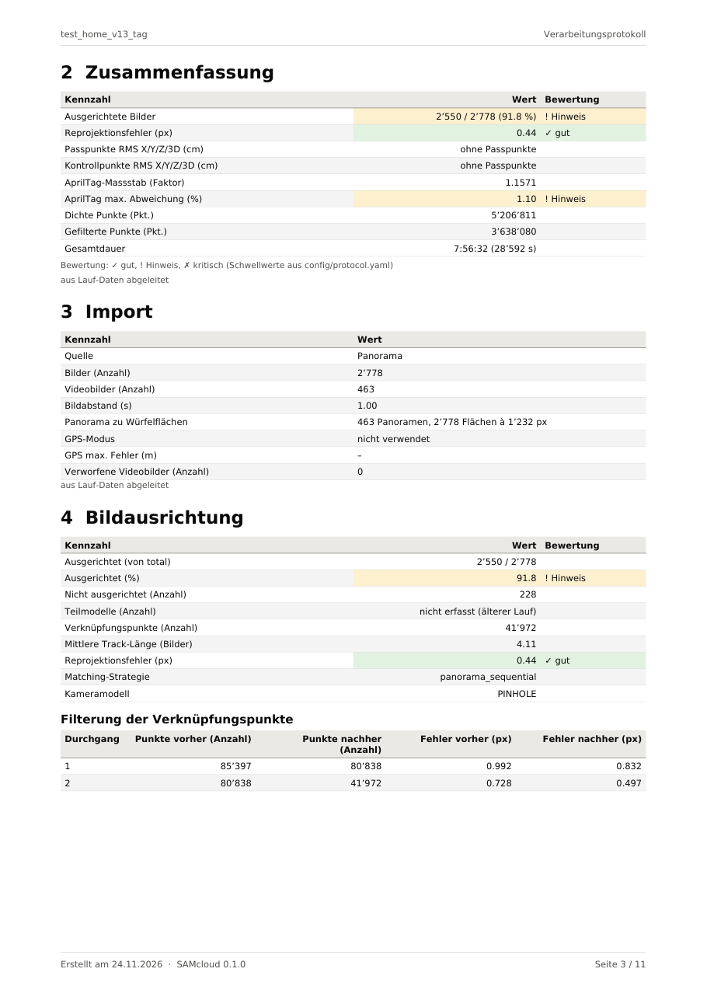

# Processing report (Verarbeitungsprotokoll)

SAMcloud writes a per-project PDF in the style of a photogrammetry
"Processing Report": what went in, how well the images aligned, how accurate
the georeference is, what the classification and the step 6 clean-up did, which
products exist and how long every step took. The code is in `samcloud/report/`.



## Contents (12 sections)

1. **Title page**: project, run date, SAMcloud version, capture type, class set, coordinate system, overview image.
2. **Summary**: key figures with a traffic light (symbol plus tint) per value.
3. **Import**: source, frames, camera, GPS, discarded video frames.
4. **Image alignment**: registered images, tie points, reprojection error, camera calibration, camera positions, image overlap.
5. **Control points and georeferencing**: errors per point in cm, RMS of pass and control points, height shift, GCP run comparison, AprilTag scale, error vectors.
6. **Dense point cloud**: points, area, density, dense settings.
7. **Geometry refinement**: executed or not, with metrics or the reason.
8. **Classification**: model, class table, instances, SAM confidence.
9. **Improve and filter (step 6)**: points removed or added per stage.
10. **Products**: files with size and CRS, DXF quality check.
11. **Runtimes**: seconds per step, hardware.
12. **Appendix**: warnings from the run log, optional camera list per image.

## Creating the report

On the **Control points** page, at the bottom, the button creates the report. It
is active when the control-point evaluation is done (or the project has no
control points) and step 6 has finished. The options *Class details* and
*Camera list per image* are next to it.

Each report is written to `reports/protocol_<YYYYMMDD_HHMM>.pdf`. An existing
file is never overwritten: a second report in the same minute gets `_2`, `_3`, ...

Command line:

```
python -m samcloud.report <project> [--lang de|en] [--camera-list] [--no-class-details] [--json-only]
```

`--json-only` only writes `reports/protocol_data.json`. `--no-camera-list`
remains accepted; the camera list is off by default.

## Configuration

`config/protocol.yaml` holds the traffic-light thresholds (green up to the first
value, yellow up to the second, red above; for the registered share it is the
other way round), the overlap grid size and the default of the optional
sections (`camera_list: false`, `class_details: true`).

## Old and new runs

New runs write `reports/processing_metrics.json` at their end. For older
projects the report derives what it can from existing reports, logs, the COLMAP
model and the score files; such sections carry the note "aus Lauf-Daten
abgeleitet" (derived from run data). A value that only a new run would record
(software version, hardware, submodels, ...) shows "nicht erfasst (älterer
Lauf)". A value that does not apply shows its own wording, e.g. "keine
AprilTags" or "ohne Passpunkte". Nothing is guessed.

`reports/protocol_data.json` holds all raw values behind the PDF, in source
units (metres, pixels, seconds). It is the basis for a later HTML export. Texts
are in `samcloud/app/locales/<lang>/protocol.json` (German and English).
